# The AncesTree guide

AncesTree keeps your family's tree on your own computer: everyone in it, how they're related, their photos and their life stories. It answers "how are these two related?" in English, Malay or Javanese, and shows the family as a tree, on a timeline and on a map.

This guide is for everyone in the family, on Windows or a Mac. New to AncesTree? Begin with [Start here](#start-here). Joining your family's AncesTree? [Quick start for relatives](#quick-start-for-relatives) has the five steps.

The guide is inside AncesTree too, for the version you have, without the internet: click **?** at the top right of the window, or open **Settings → Help**. Beside the harder steps in AncesTree, **How does this work?** opens the part of the guide about them.

## Contents

*Part 1: Get started*

- [Start here](#start-here)
- [Quick start for relatives](#quick-start-for-relatives)

1. [Words used in this guide](#1-words-used-in-this-guide)
2. [Install AncesTree](#2-install-ancestree): [on Windows](#on-windows), [on a Mac](#on-a-mac)
3. [The first start](#3-the-first-start)
4. [Opening and closing AncesTree](#4-opening-and-closing-ancestree)

*Part 2: Use AncesTree*

5. [A tour of the window](#5-a-tour-of-the-window)
6. [The tree](#6-the-tree)
7. [Looking at someone](#7-looking-at-someone)
8. [Adding and changing people](#8-adding-and-changing-people)
9. [Life stories](#9-life-stories)
10. [How are two people related?](#10-how-are-two-people-related)
11. [Me: telling AncesTree who you are](#11-me-telling-ancestree-who-you-are)
12. [The timeline](#12-the-timeline)
13. [The map](#13-the-map)
14. [Family facts, and what's missing](#14-family-facts-and-whats-missing)
15. [Kinship words and the dictionary](#15-kinship-words-and-the-dictionary)
16. [Copies for phones, and other files](#16-copies-for-phones-and-other-files)
17. [Bringing people in from a spreadsheet](#17-bringing-people-in-from-a-spreadsheet)

*Part 3: The family folder*: [keeping in step](#keeping-in-step), [signing in to Google](#signing-in-to-google)

18. [For relatives: join your family](#18-for-relatives-join-your-family)
19. [For the keeper: start and look after the family folder](#19-for-the-keeper-start-and-look-after-the-family-folder): [your family's Google project](#your-familys-google-project)

*Part 4: Look after AncesTree*

20. [Backups](#20-backups): [copies in another place](#copies-in-another-place), [when something is lost](#when-something-is-lost)
21. [Several families on one computer](#21-several-families-on-one-computer)
22. [Updates](#22-updates)
23. [Keep your computer safe](#23-keep-your-computer-safe)
24. [Where AncesTree keeps the family](#24-where-ancestree-keeps-the-family)
25. [When something goes wrong](#25-when-something-goes-wrong)
26. [Removing AncesTree](#26-removing-ancestree)
27. [Linux](#27-linux)

---

# Part 1: Get started

## Start here

AncesTree is an app for your family's history. You install it on your computer, and the family lives there: each person, how they're related, their photos and their life stories. Nothing of your family is ever sent to AncesTree's maintainer.

Each relative who joins has the same family on their own computer. One person, **the keeper**, looks after the family's record. A relative's changes wait for the keeper, who looks at each one before it reaches everyone else. A private folder in the keeper's Google Drive, **the family folder**, carries the family between the computers:

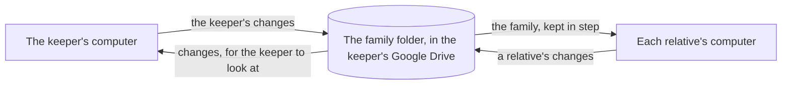

- Everything in the family folder is locked on the family's computers before it goes there: Google keeps the files, but can't read them.
- Only the Google accounts the keeper invites can open the family folder, and the keeper lets in each computer.
- A family can also be kept on one computer alone, without any of this.
- Every family is its own: whoever installs AncesTree can keep their own family, through their own Google account. One computer can hold several families too, such as your mother's side and your father's, each kept apart.

*Which parts you need:*

| You are | Read |
|---|---|
| A relative, joining your family | [Quick start for relatives](#quick-start-for-relatives). Each step is in full in [Install AncesTree](#2-install-ancestree) and [Join your family](#join). Then [Part 2](#part-2-use-ancestree), as you like |
| The keeper, starting the family's AncesTree | [Install AncesTree](#2-install-ancestree), then [For the keeper](#19-for-the-keeper-start-and-look-after-the-family-folder) |
| Keeping a family on one computer, alone | [Install AncesTree](#2-install-ancestree) and [The first start](#3-the-first-start), then [Part 2](#part-2-use-ancestree) |
| Anyone, later on | [Backups](#20-backups), [Updates](#22-updates) and [When something goes wrong](#25-when-something-goes-wrong) |

*How this guide is written:*

- Words in **bold** are what you see on the screen, exactly: a button, a menu or a message.
- Each task says what it's for, who does it, and what you need before you start. Then come its steps, one action each, and what to do if it doesn't work.
- The words AncesTree uses are in [Words used in this guide](#1-words-used-in-this-guide).

## Quick start for relatives

- *What it's for:* AncesTree on your computer, with your family in it, from the download to seeing the family.
- *Who does it:* a relative whom the keeper invited.
- *Before you start:* a computer with Windows 10 or 11, or a Mac with an M1 chip or newer; the internet; the Google account your keeper invited; and your keeper's message with the invitation. Have your keeper on the phone, or able to message you, for the last step.

1. *Download AncesTree.* Open your keeper's message, and click its first link: AncesTree's latest release. Scroll down to **Assets**, and click `AncesTree_<version>_x64-setup.exe` on Windows, or `AncesTree_<version>_aarch64.dmg` on a Mac.
2. *Install it.* Open the file you downloaded. Your computer warns you about it, once: on Windows, click **More info**, then **Run anyway**; on a Mac, follow [On a Mac](#on-a-mac). The first time AncesTree starts, it fetches its database, for a minute or two.
3. *Paste the invitation.* AncesTree says **Welcome to AncesTree**: click **Join or start**. Copy your keeper's whole message. Click in the box under **Join your family's AncesTree**, press **Ctrl+V**, and click **Use this invitation**.
4. *Sign in to Google* with the account your keeper invited. Google says it hasn't verified the app: click **Advanced**, then **Go to AncesTree (unsafe)**. Tick both boxes, click **Continue**, and close the browser's tab.
5. *Ask to join.* Type a name for this computer, such as *Mak Long's laptop*, and click **Ask to join**. Read the code AncesTree shows to your keeper. Once they let your computer in, the family arrives by itself.

*If it doesn't work:* each step is in full, with pictures, in [Install AncesTree](#2-install-ancestree) and [Join your family](#join). What AncesTree's messages mean, and what to do, is in [When something goes wrong](#25-when-something-goes-wrong).

## 1. Words used in this guide

| Word | What it means |
|---|---|
| *Click* | Press the left mouse button once, or tap a laptop's touchpad once. |
| *Double-click* | Click twice, quickly. |
| *Right-click* | Press the right mouse button. On a Mac, hold **Control** and click. |
| *Drag* | Press and hold the mouse button on something, move the mouse, then let go. |
| *Point at* | Move the mouse over something, without clicking. |
| *The window* | AncesTree's own window on your screen, with the family in it. |
| *The icon by the clock* | AncesTree's small icon: a green square with a little family tree on it. On Windows it's at the bottom right, by the clock. On a Mac it's at the top right, in the menu bar. |
| **Ctrl** | The key marked **Ctrl** on Windows. On a Mac, use **⌘ Command** wherever this guide says **Ctrl**. |
| *The keeper* | The one person who looks after the family's record. Their computer keeps the family, and lets relatives' computers in. |
| *A relative* | Anyone else in the family with AncesTree. Their computer has the same family, kept in step with the keeper's. |
| *The family folder* | A private folder in the keeper's Google Drive, which carries the family between the family's computers. It's locked: Google keeps it, but can't read it. |
| *In step* | A computer has the family as it is in the family folder. AncesTree keeps it so by itself. |
| *The family's Google project* | The keeper's own free Google Cloud project, through which every family computer reaches the family folder. The keeper sets it up once. |
| *The client's file* | A small file from the family's Google project, which the keeper gives AncesTree. Invitations carry what's in it to relatives. |
| *The invitation* | A line of text, starting with `ATI1-`, that the keeper sends a relative so that they can join. It comes in a message with a few lines on installing AncesTree. |
| *The code* | Eight letters and numbers that a joining computer shows. The relative reads it to the keeper, who lets the computer in only if theirs shows the same. |
| *The recovery code* | The keeper's code, kept on paper. With it, the keeper can keep the family on a new computer. Without it, no one can. |
| **Contributor**, **Trusted**, **Viewer** | What a relative's computer may do, which the keeper chooses: see [What your computer may do](#what-your-computer-may-do). |
| *A backup* | A copy of the whole family, made each day by itself, to go back to if something goes wrong. |
| *A view-only copy* | The whole family in one file, for relatives on phones and computers without AncesTree. Nothing in it can be changed. |
| *A married-in family* | The family of someone who married into yours: their parents, brothers and sisters. |

## 2. Install AncesTree

- *What it's for:* putting AncesTree on your computer.
- *Who does it:* everyone who uses AncesTree on a computer.
- *Before you start:*
  - a Windows computer with Windows 10 or 11, or a Mac with Apple Silicon (an M1 chip or newer) and macOS 11 or newer;
  - the internet, the first time AncesTree starts. It fetches about 330 MB once;
  - to join your family: a Google account, which you tell your keeper, and the invitation your keeper sends you.

Phones and tablets can't install AncesTree. Your keeper can send you a copy to look at instead (see [Copies for phones](#16-copies-for-phones-and-other-files)).

To check that a download is the one AncesTree's maintainer released, see *Checking a download* in [SECURITY.md](SECURITY.md). It's for the careful, and not needed to install.

*Download AncesTree:*

1. Open the [latest release of AncesTree](https://github.com/khilfi/ancestree/releases/latest) in your web browser, or click the first link in your keeper's message.
2. Scroll down to **Assets**.
3. Click the file for your computer:

| Your computer | The file to click |
|---|---|
| Windows | `AncesTree_<version>_x64-setup.exe` |
| Mac | `AncesTree_<version>_aarch64.dmg` |

It goes to your **Downloads** folder.

*Why your computer warns you:* AncesTree is made for one family. It doesn't carry the paid signature that big companies' programs carry, so Windows and the Mac warn you about it, once, while you install it. The steps below show each warning and what to choose. After that, AncesTree updates itself, and only ever installs updates signed by its maintainer.

### On Windows

1. Open your **Downloads** folder, and double-click `AncesTree_<version>_x64-setup.exe`.
2. Windows says **Windows protected your PC**. Click **More info**.
   <!-- picture: guide/windows-1-protected.png (Windows protected your PC) -->
3. Click **Run anyway**.
   <!-- picture: guide/windows-2-run-anyway.png (the same, with Run anyway) -->
4. The installer opens. Click **Next**, then **Install**. It installs AncesTree for you alone, so it doesn't ask for an administrator's password.
   <!-- picture: guide/windows-3-installer.png (the installer's first page) -->
5. At the end, keep **Run AncesTree** ticked, and click **Finish**. Tick **Create desktop shortcut** too if you'd like an icon on your desktop.
   <!-- picture: guide/windows-4-finish.png (the last page, Run AncesTree ticked) -->

AncesTree starts. Go on to [The first start](#3-the-first-start).

*If Windows says Smart App Control blocked it,* and there's no **Run anyway**, Smart App Control is switched on. It lets in only programs with the paid signature. To install AncesTree, switch it off:

1. Click **Start**, type **Smart App Control**, and open **Smart App Control settings**.
2. Choose **Off**.
   <!-- picture: guide/windows-5-smart-app-control.png (Smart App Control settings) -->
3. Open the installer again.

Switching it off is your choice. Windows may not let you switch it back on without setting up Windows again. Microsoft Defender keeps protecting your computer either way.

### On a Mac

1. Open your **Downloads** folder, and double-click `AncesTree_<version>_aarch64.dmg`.
2. In the window that opens, drag AncesTree onto the **Applications** folder.
   <!-- picture: guide/mac-1-drag-to-applications.png (the disk image's window) -->
3. Open AncesTree from your **Applications** folder. Your Mac says it couldn't check that AncesTree is safe, and doesn't open it. Click **Done**. Don't click **Move to Trash**.
   <!-- picture: guide/mac-2-not-opened.png (the Mac's message, with Done) -->
4. Open **System Settings**, then **Privacy & Security**. Scroll down to **Security**, where it says AncesTree was blocked. Click **Open Anyway**.
   <!-- picture: guide/mac-3-open-anyway.png (Privacy & Security, with Open Anyway) -->
5. Your Mac asks once more. Click **Open Anyway**, then type your Mac's password, or use Touch ID.
   <!-- picture: guide/mac-4-open-anyway-again.png (the Mac asking once more) -->

AncesTree starts, and from then on opens like any other app. Go on to [The first start](#3-the-first-start).

*If it doesn't work:* if your Mac has an Intel chip, AncesTree can't run on it: it needs an M1 chip or newer. To see which chip your Mac has, open the Apple menu, then **About This Mac**.

## 3. The first start

- *What it's for:* AncesTree's first start on a computer. It fetches the database it keeps the family in, then asks about your family.
- *Who does it:* everyone, once on each computer.
- *Before you start:* the internet, for about 330 MB.

1. AncesTree starts by itself after installing. The window says how far it has got: it fetches the database, and the Java the database runs on, and checks each before it's used. This happens only once, and takes a minute or two on a good connection.
   <!-- picture: guide/first-start.png (the window while it fetches its database) -->
2. On a new computer, AncesTree then asks about your family, in a bar at the top: **Welcome to AncesTree**. Has your family's keeper sent you an invitation? Join with it, or start your family's own.
   - A relative clicks **Join or start**, then follows [Join your family](#join).
   - The keeper clicks **Join or start**, then follows [For the keeper](#19-for-the-keeper-start-and-look-after-the-family-folder).
   - To keep the family on this computer alone, or to look around first, click **Not now**. AncesTree works without a family folder. You can join or start one later, from **Settings → Family folder**.

After this, AncesTree opens in a few seconds.

*If it doesn't work:* if AncesTree says **AncesTree needs the internet this once, to fetch its database**, connect to the internet: it tries again by itself.

## 4. Opening and closing AncesTree

AncesTree starts by itself when you sign in to your computer, without opening its window. It keeps your family in step in the background while it runs.

Its icon is by the clock. On Windows, it's at the bottom right; if you can't see it, click the small **^** arrow beside the clock. On a Mac, it's in the menu bar at the top right.

<!-- picture: guide/tray-menu.png (the icon's menu) -->

- *To open the window:* click the icon. Or right-click the icon and choose **Open AncesTree**. On a Mac, you can also click AncesTree in the Dock.
- *Closing the window doesn't stop AncesTree.* It keeps running by the clock, on purpose: it keeps the family in step while it runs.
- *To open AncesTree after quitting it:* on Windows, click **Start** and type *AncesTree*. On a Mac, open it from **Applications**.
- *Point at the icon* to see which family is open, and when it was last in step with its family folder.

The icon's menu (right-click the icon):

| Choice | What it does |
|---|---|
| **Open AncesTree** | Opens the window. |
| **Sync now** | Keeps the family in step with its family folder now, rather than within the minute (see [Keeping in step](#keeping-in-step)). |
| **Start when I sign in** | Ticked: AncesTree starts by itself when you sign in. Click it to untick. |
| **Check for updates** | Looks for a new version now (see [Updates](#22-updates)). |
| **Quit AncesTree** | Stops AncesTree completely, until you open it again. |

---

# Part 2: Use AncesTree

The pictures in this part show a made-up family, *Keluarga Contoh*. Your own family appears in their place.

Everyone can do what this part shows, but where it says *for the keeper*. On a relative's computer, what you change waits for the keeper, who looks at it before it reaches the rest of the family (see [Your changes](#your-changes)). On a computer let in as a **Viewer**, nothing can be changed.

## 5. A tour of the window

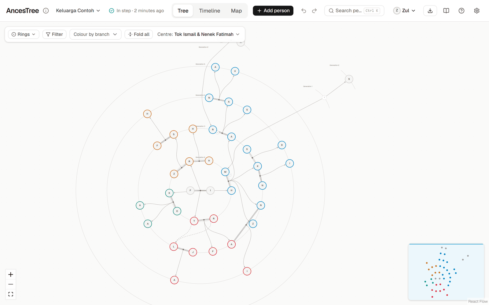

The bar along the top:

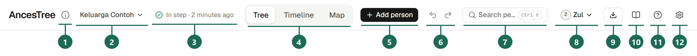

| | Name | What it does |
|---|---|---|
| 1 | **Family facts** | Facts about the whole family at a glance (see [Family facts](#14-family-facts-and-whats-missing)). |
| 2 | The family's name | The family you're looking at. Click it to open another family on this computer, or to add one (see [Several families on one computer](#21-several-families-on-one-computer)). |
| 3 | **In step** · 2 minutes ago | Only with a family folder: how the family stands with it. Click it to see more, or to keep in step at once (see [Keeping in step](#keeping-in-step)). |
| 4 | **Tree**, **Timeline**, **Map** | Three ways to see the family. Click one to switch. |
| 5 | **Add person** | Adds someone new (see [Adding people](#8-adding-and-changing-people)). |
| 6 | **Undo** and **Redo** | Undo takes back your last change; Redo puts it back again. Point at them to see which change. |
| 7 | **Search people…** | Finds someone by name or nickname. |
| 8 | **Me** | Tells AncesTree who you are. Once you've chosen, it shows your name (see [Me](#11-me-telling-ancestree-who-you-are)). |
| 9 | **Export** | Copies for phones, and files for other programs (see [Copies](#16-copies-for-phones-and-other-files)). |
| 10 | **Dictionary** | The words for relatives in English, Malay and Javanese. |
| 11 | **?** (**Guide**) | This guide, inside AncesTree. |
| 12 | **Settings** | Settings, backups, the Trash, and the family folder. A number here means something waits for you there. |

Some show only their icon unless the window is wide, such as Export, Dictionary and Settings, and more in a smaller window. **Guide** shows only its **?** unless the window is very wide. Point at an icon to see its name.

Undo works for almost everything: adding, changing, linking and removing people. Press **Ctrl+Z** to undo and **Ctrl+Y** to redo. Undo reaches back to when AncesTree last started.

To find someone quickly, click **Search people…** (or press **Ctrl+K**), and type part of their name or nickname. Click a name to fly to them on the tree. Typing the start of two words also works: "sit rah" finds Siti binti Rahman.

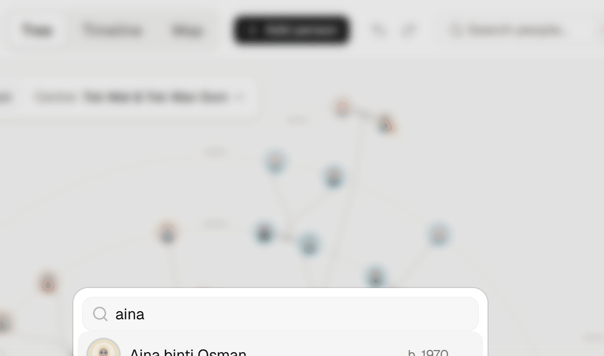

## 6. The tree

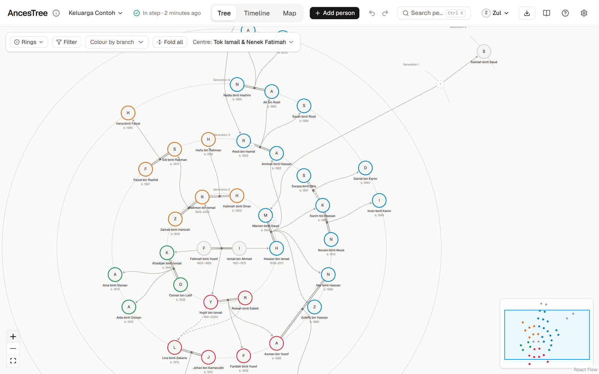

The tree starts with the family's oldest ancestor at the centre. Each ring around them is a generation: their children on the next ring, their grandchildren on the next, and so on. Each person is a circle with their photo, or their first letter, and their name and years underneath.

*Moving around:*

| To | Do this |
|---|---|
| Move the tree | Drag an empty part of it. |
| Zoom in or out | Turn the mouse wheel, or pinch on a touchpad. Or click **+** and **−** at the bottom left. |
| See everyone again | Click the square button under **−**, or press **F**. |
| Open someone | Click them. |
| See more about someone | Point at them: a card shows their full name, years, age and birthplace. |

*The lines between people:*

- a solid line joins a child to a birth parent; a dashed line, to an adoptive or foster parent;
- a double line joins a married couple; it's dashed when they divorced;
- children hang from a small dot between their two parents.

*The tools along the top of the tree:*

- **Rings** (or the name of the layout you're using) changes how the tree is laid out.
- **Filter** shows only some of the family.
- **Colour by branch** chooses what the colours mean.
- **Fold all** and **Unfold all** hide and show families who married in.
- **Centre:** chooses which family is in the middle.

### Layouts

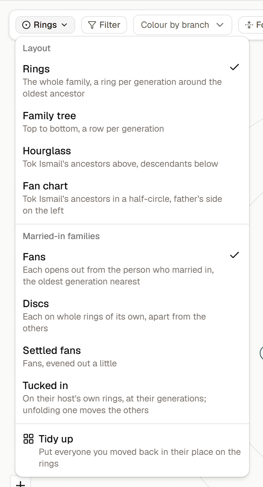

| Layout | What it shows |
|---|---|
| **Rings** | The whole family, a ring per generation around the oldest ancestor. |
| **Family tree** | Top to bottom, a row per generation. |
| **Hourglass** | Someone's ancestors above them, and their descendants below. |
| **Fan chart** | Someone's ancestors in a half-circle, their father's side on the left. |

For **Hourglass** and **Fan chart**, click someone on the tree to put them in the middle, and use **−** and **+** beside **Generations** to show more or fewer.

On the rings you can drag people to where you'd like them; AncesTree remembers. **Tidy up**, in the same menu, puts everyone back in their place.

*Families who married in:* when someone married into the family, their own family can be on the tree too: their parents, brothers and sisters, beside them. On the rings, choose how they're placed under **Married-in families**, in the same menu:

| Choice | What you see |
|---|---|
| **Fans** | Each family opens out from the person who married in, their parents nearest, each later generation further out. AncesTree starts with this. |
| **Discs** | Each family on whole rings of its own, apart from the others. |
| **Settled fans** | Fans, evened out a little. |
| **Tucked in** | Their people on the family's own rings, at their generations. Unfolding one moves the others. |

Whichever you choose, nobody's photo covers another's. Each computer keeps its own choice. The line from each of these families to the person who married in finds its way between the others, never over anyone's photo.

### Showing only some of the family

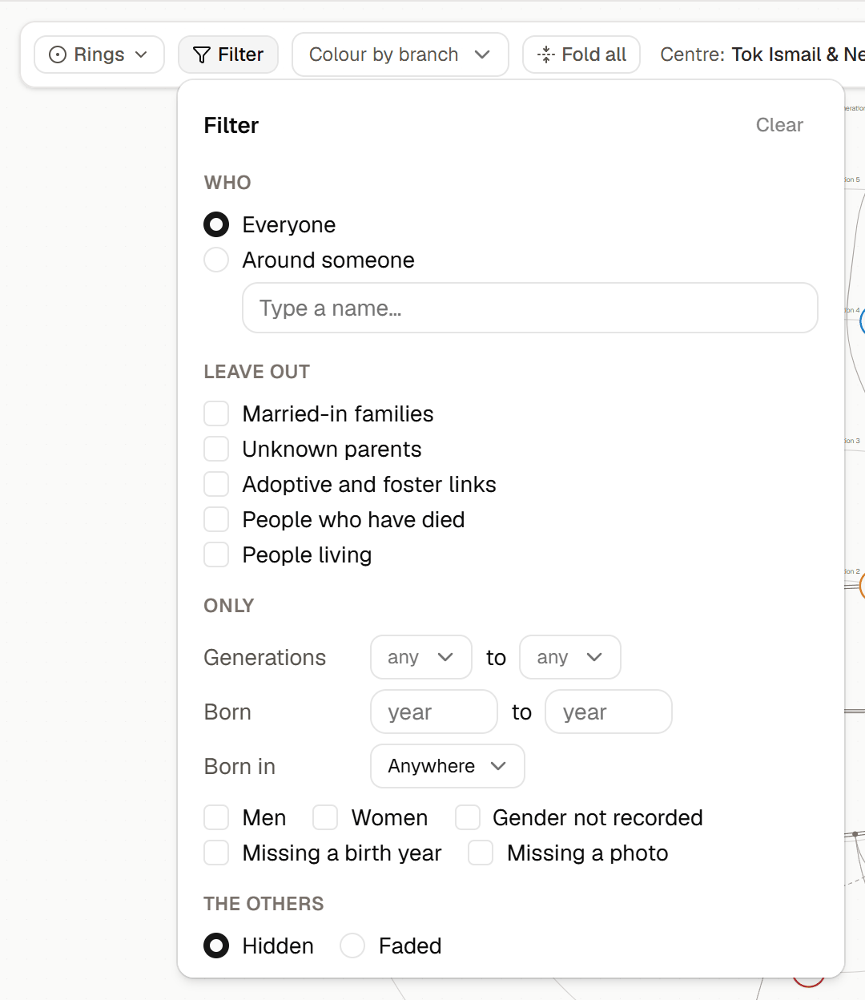

Click **Filter**, then choose:

- **Who**: **Everyone**, or **Around someone**: type a name, then choose their **Direct line**, **Ancestors**, **Descendants**, **Blood relatives** or those **Within a few links**;
- **Leave out**: families who married in, unknown parents, adoptive and foster links, people who have died, or people living;
- **Only**: some generations, people born between two years or in one place, men or women, or those missing a birth year or a photo;
- **The others**: **Hidden**, or **Faded** to keep them in view but pale.

What you choose shows as small labels under the tools. Click **×** on a label to take it away, or **Clear all**. The filter also applies to the timeline and the map.

### Families and the centre

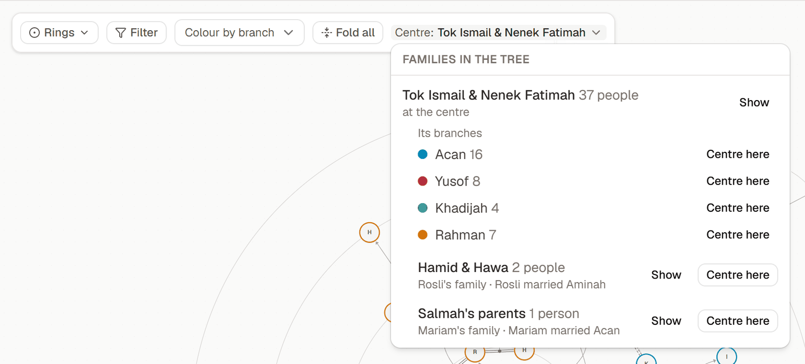

Click **Centre:** to see the families in the tree: the main one, its branches, and the families who married in. Click **Centre here** to put one in the middle, or **Show** to light it up. **Use the oldest ancestor** puts the tree back as it was.

### Colours

- **Colour by branch**: each child of the oldest ancestors, and their descendants, get a colour of their own.
- **Colour by generation**: a colour per generation.
- **Colour by closeness to me**: how closely each person is related to you. This needs [Me](#11-me-telling-ancestree-who-you-are).
- **No colours**.

## 7. Looking at someone

Click someone on the tree. Their panel opens beside the tree.

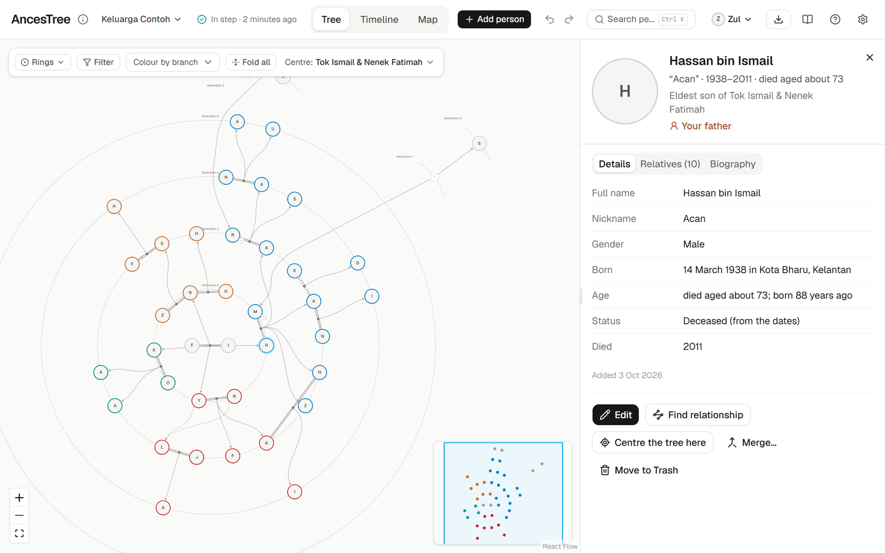

At the top: their name, nickname, years and age, which child they are (for example "Eldest son of…"), and, once you've chosen [Me](#11-me-telling-ancestree-who-you-are), what they are to you, such as "Your father".

The panel has three tabs:

- **Details**: everything recorded about them, such as when and where they were born, where they live, and their occupation. Below it, **Who changed this** lists the latest changes to them, and which computer they came from.
- **Relatives**: their parents, husband or wife, brothers and sisters, and children.
- **Biography**: their life story (see [Life stories](#9-life-stories)).

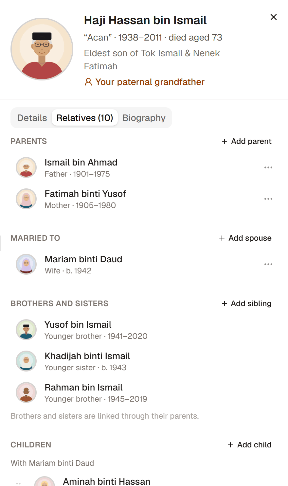

The buttons at the bottom of **Details**:

| Button | What it does |
|---|---|
| **Edit** | Change their details. |
| **Find relationship** | How is someone else related to them? (see [How are two people related?](#10-how-are-two-people-related)) |
| **Centre the tree here** | Puts them at the middle of the tree. **Undo centre** puts it back. |
| **Merge…** | For someone entered twice (see [Merge](#someone-entered-twice)). |
| **Move to Trash** | Takes them out of the tree, for 30 days (see [Removing someone](#removing-someone)). |

To close the panel, click **×** at its top right.

## 8. Adding and changing people

On a relative's computer, what you add and change waits for your keeper, who looks at it before it reaches the rest of the family. It shows on your computer straight away. See [Your changes](#your-changes). If your keeper let your computer in as a **Viewer**, nothing can be changed on it.

### Adding someone new

- *What it's for:* putting someone new in the family.
- *Who does it:* anyone whose computer may change the family.

1. Click **Add person** in the top bar.
2. Type their **Full name**. It's the only thing you must fill in.
3. Fill in anything else you know (see [The details](#the-details) below).
4. Click **Add person** at the bottom.

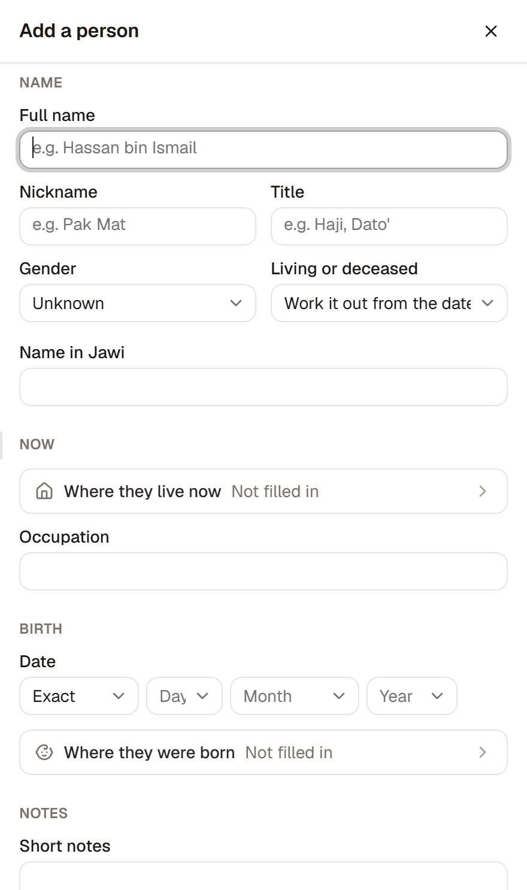

They appear on the tree, not yet linked to anyone. To link them, see [Adding a relative](#adding-a-relative) and [Linking two people](#linking-two-people-already-in-the-tree).

### Changing someone's details

- *What it's for:* putting right, or adding to, what's recorded about someone.
- *Who does it:* anyone whose computer may change the family.

1. Click them on the tree.
2. Click **Edit**.
3. Change what you need.
4. Click **Save**. Or **Cancel** to leave everything as it was.

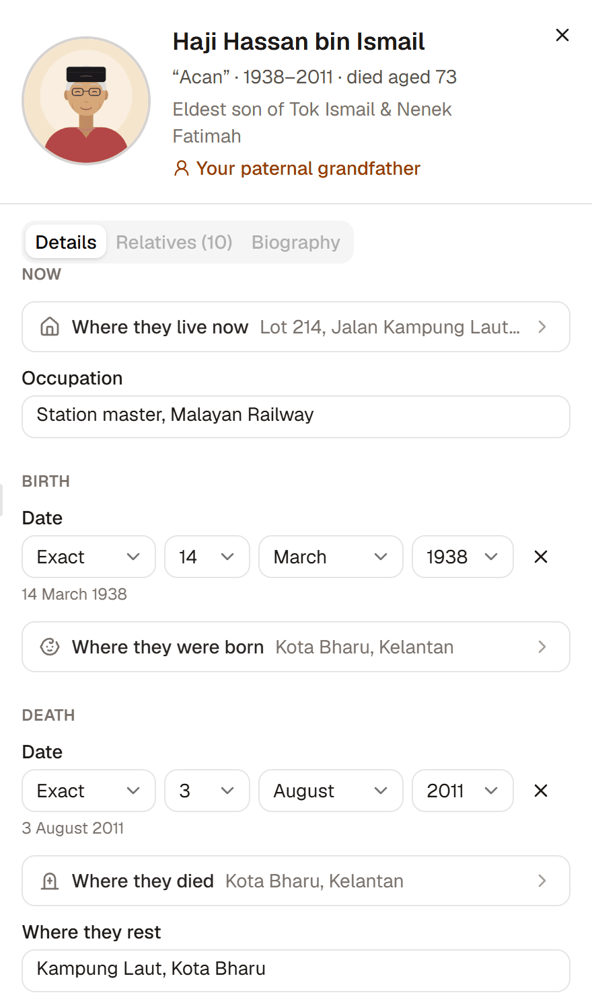

### The details

- *Name:* their **Full name**, **Nickname** (for example *Pak Mat*), **Title** (for example *Haji* or *Dato'*), **Gender**, and **Name in Jawi**.
- *Birth:* the **Date**, and the place: town, state and country.
- *Death:* **Living or deceased**, the date and place, and where they're **Buried at**. Leave **Living or deceased** on **Work it out from the dates** if you're not sure.
- *Now:* where they live, and their **Occupation**.
- *Notes:* a few short notes. Write longer things in their [life story](#9-life-stories).

*Dates:* first choose how sure the date is: **Exact**, **About**, **Before**, **After** or **Between**. Then pick the day, month and year from the lists. A year alone is enough. While a list is open, typing jumps to it: type "19" then "38" for 1938, or "feb" for February. The **×** clears the date.

*Places:* type the town, choose the state, and check the country, which starts as Malaysia. The [map](#13-the-map) uses these.

### Adding a relative

- *What it's for:* adding someone's parent, husband or wife, brother or sister, or child, linked to them at once.
- *Who does it:* anyone whose computer may change the family.

1. Click the person on the tree, then the **Relatives** tab.
2. Click **+** beside **Parents**, **Married to**, **Brothers and sisters** or **Children**.
3. Choose **Someone new**, and type their name and anything else you know. Or choose **Already in the tree**, and find them by name.
4. Click **Add** (or **Link**).

A new brother or sister shares the parents already recorded. If none are recorded, an "unknown parent" joins them for now, shown as **?** on the tree. Click the **?** later to fill them in.

### Linking two people already in the tree

- *What it's for:* saying how two people already in the tree are related.
- *Who does it:* anyone whose computer may change the family.

1. Point at the first person on the tree. A small blue arrow appears at their edge.
2. Drag the arrow onto the second person.
3. Choose what the first person is to the second: for example **Father**, **Daughter**, **Wife** or **Brother**. **More…** shows other kinds, such as an adoptive father.

To change or remove a link, click the line between the two people, or use the **…** button beside a relative in the **Relatives** tab. There you can change the kind of link (for example to adoptive), change a marriage to **Divorced** or **Widowed**, or click **Remove link**. Removing a link keeps both people.

### Birth order

AncesTree works out who's eldest from their dates of birth. When it can't be sure, the **Relatives** tab says so: drag the children into order, eldest first, by the handle beside each name.

### Photos

- *What it's for:* a photo of someone, in their circle on the tree and in their panel.
- *Who does it:* anyone whose computer may change the family.
- *Before you start:* the photo on your computer: JPEG, PNG, WebP, HEIC, GIF, BMP or TIFF, up to 20 MB.

1. Click the person on the tree.
2. Click the circle at the top of their panel.
3. Click **Choose a photo…**, and choose a photo from your computer.
4. Drag the photo and use **Zoom** to fit their face in the circle.
5. Click **Save photo**.

To crop it again later, click the circle and **Adjust crop**. **Remove** takes the photo off. AncesTree keeps a photo without what the camera wrote into it, such as where it was taken, so that never travels with the family.

*If it doesn't work:* a photo over 20 MB won't go in. Make a smaller copy of it, and choose that.

### Removing someone

- *What it's for:* taking someone out of the tree, with their links.
- *Who does it:* anyone whose computer may change the family.

1. Click them on the tree, then **Move to Trash**.
2. Click **Move to Trash** again to confirm.

Everything can be brought back, photo included, for 30 days: click **Undo** at once, or open **Settings → Trash** and click **Restore** beside them.

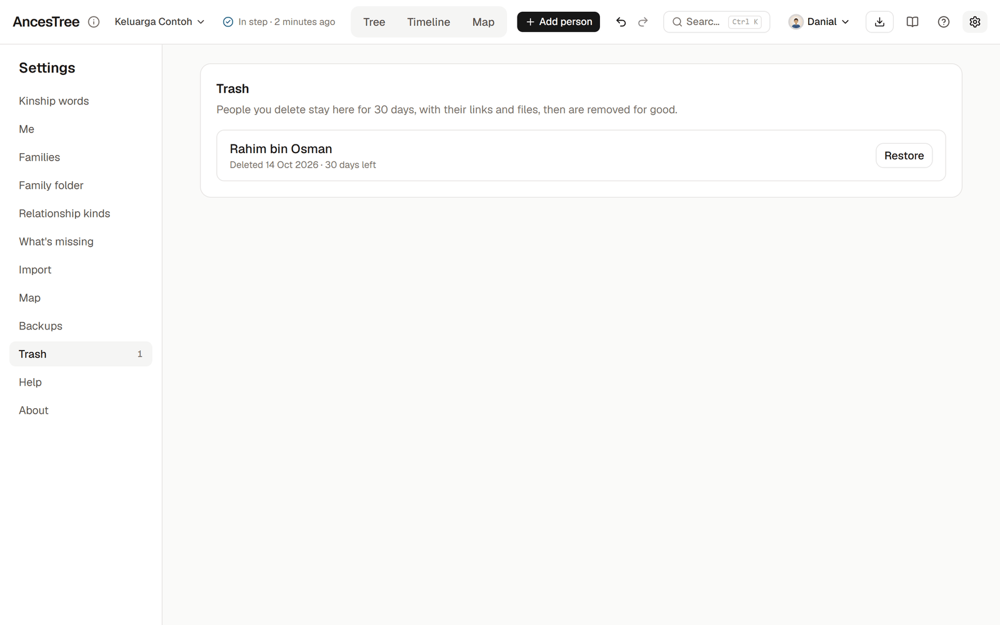

### Kinds of parent link

- *What it's for:* the kinds of parent a child can have besides birth: adoptive, foster, or one you add, such as guardian.
- *Who does it:* the keeper.

Only birth links count as blood, for the tree's lineage and the relationship finder.

1. Open **Settings → Relationship kinds**.
2. Click **Add kind**, and type what the parent and the child are called, in English and, if you like, Malay and Javanese.
3. Choose whether it's **Offered** when linking, and whether such children sit under that parent on the tree (**In the tree**).

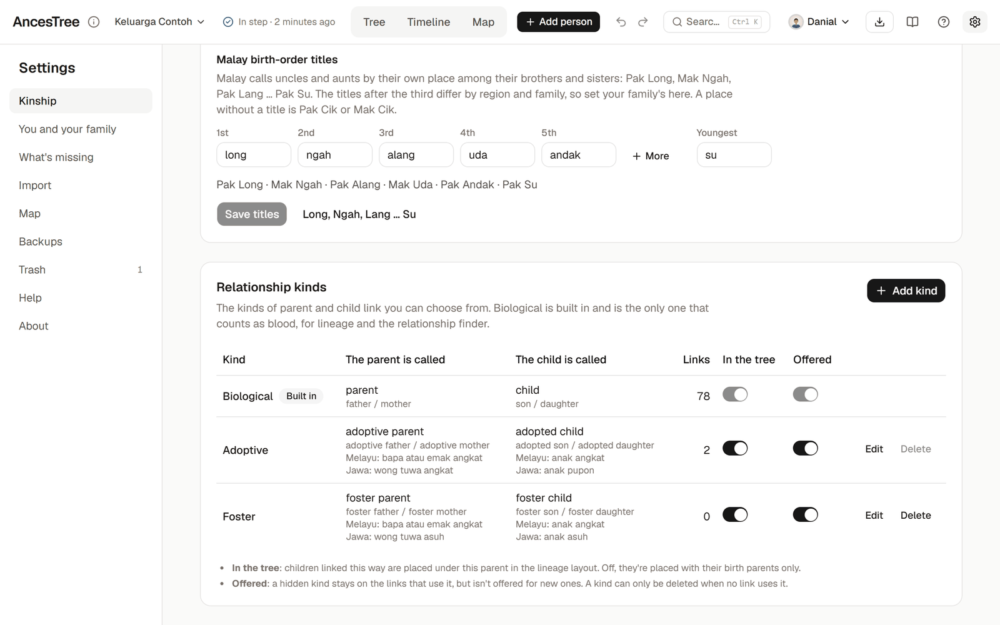

### Someone entered twice

- *What it's for:* making one person of someone who's in the tree twice.
- *Who does it:* anyone whose computer may change the family.

1. Click the one you want to keep, then **Merge…**.
2. Type the other one's name, and choose them.
3. Check what will happen: the details and links that move across.
4. Click **Merge … into …** to confirm.

The one you kept takes the other's details where they have none, and all of their links. The other goes to the Trash. **Undo** puts them back as two.

## 9. Life stories

- *What it's for:* someone's life story, with pictures and sources.
- *Who does it:* anyone whose computer may change the family.

1. Click the person on the tree, then the **Biography** tab.
2. Write their story. It saves itself as you type; it says **Saved** when it has.

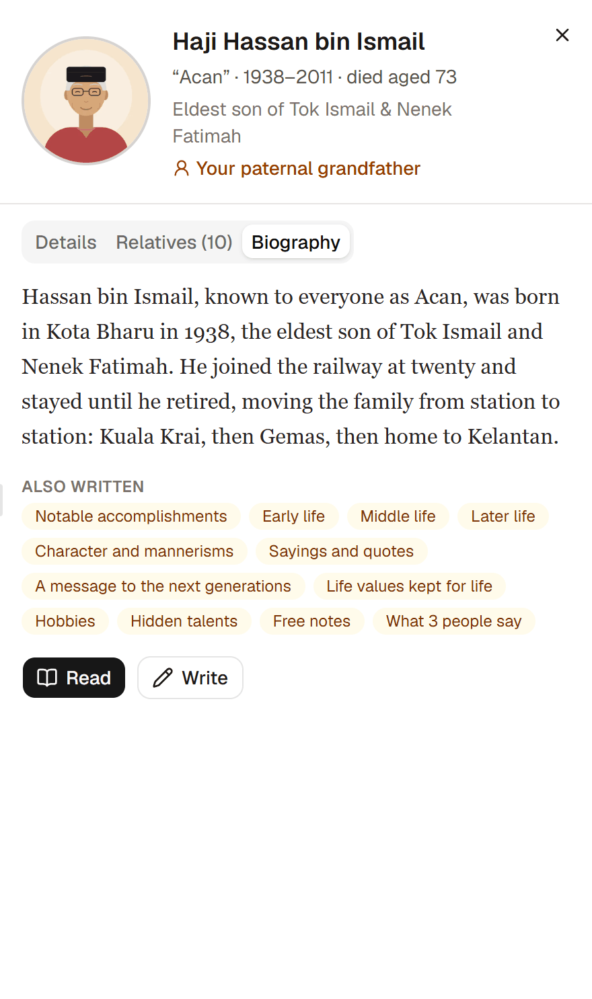

- **Wide view** opens a big page for writing. **Back to the panel** returns.
- The buttons above the story make text bold or italic, add headings, lists and links.
- **Add a picture** puts a photo inside the story, with a caption. You can also drag a picture into the story.
- Under the story, **Sources** lists where it came from: "Birth certificate, 1938", or "A talk with Nenek". Click **Add a source** for each.

## 10. How are two people related?

- *What it's for:* what one person is to another, in English, Malay or Javanese, with the path between them on the tree.
- *Who does it:* everyone.

1. Click the first person on the tree, then **Find relationship**.
2. A yellow bar asks you to click anyone. Click the second person on the tree. Or press **Ctrl+K** and search for them.

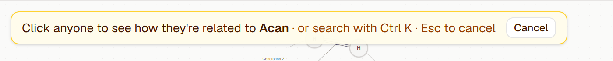

The answer appears in the panel, and the path between them lights up on the tree.

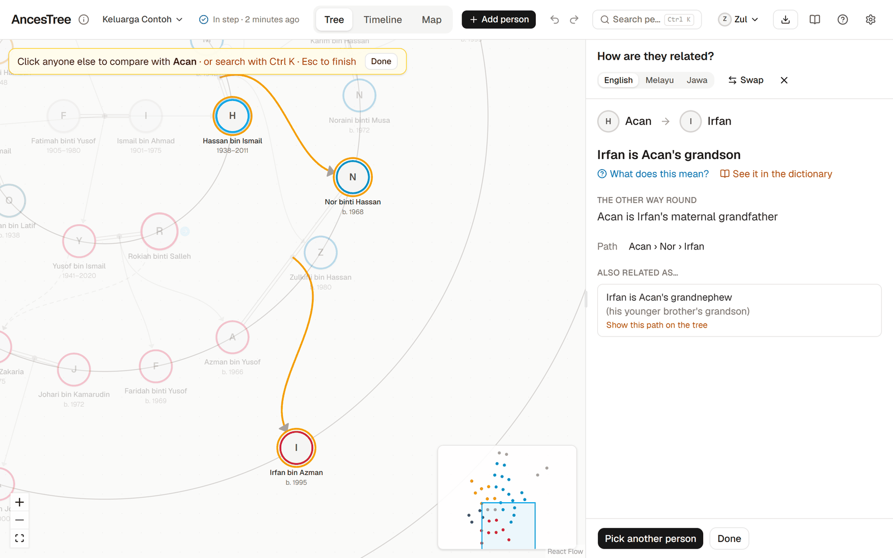

- **English**, **Melayu** and **Jawa** switch the language of the answer.
- **What does this mean?** explains it, for example by their shared grandparents.
- **The other way round** gives the answer from the second person's side.
- **Also related as…** shows other ways they're related, if there are any.
- **Swap** swaps the two people. **Pick another person** compares the first person with someone else. **Done** finishes.

## 11. Me: telling AncesTree who you are

- *What it's for:* telling AncesTree which person in the family you are. Every panel then says what each person is to you, like "your pak long", and the tree can colour everyone by how close they are to you.
- *Who does it:* everyone, on their own computer.

1. Click **Me** in the top bar.
2. Type your name, and click yourself in the list.

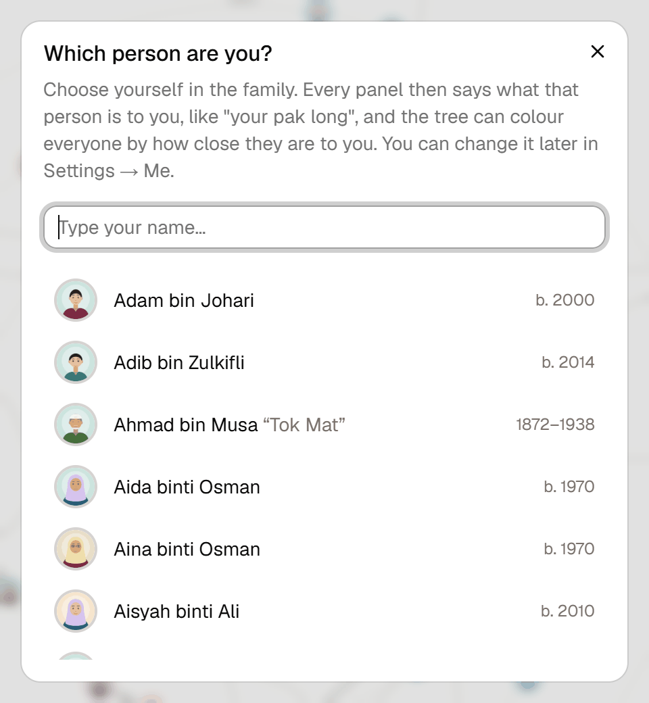

Once you've chosen, the **Me** button shows your name. Click it for these choices:

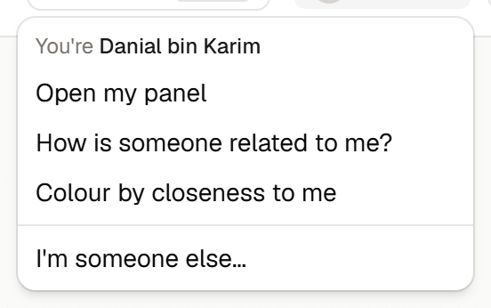

- **Open my panel**;
- **How is someone related to me?**;
- **Colour by closeness to me**;
- **I'm someone else…**, to choose again.

Each computer keeps its own choice. **Settings → Me** also has **Forget who I am**.

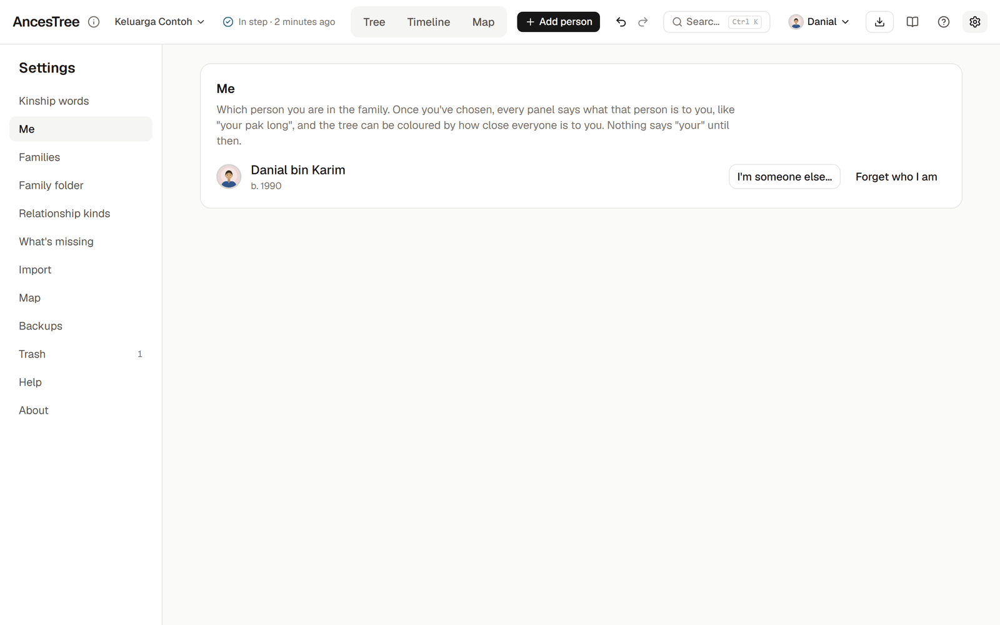

## 12. The timeline

Click **Timeline** in the top bar. Everyone appears along the years, with a bar across their life.

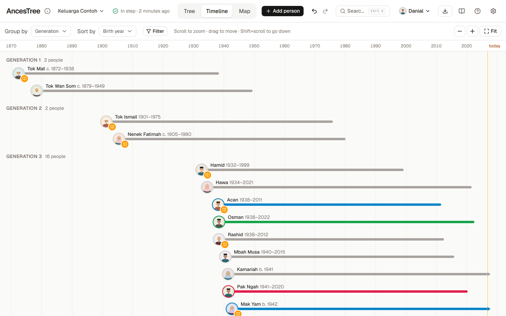

- **Group by** puts people in rows by **Generation** or **Branch**. **Sort by** orders them.
- Turn the mouse wheel to zoom in and out on the years. Drag to move along them. Hold **Shift** and turn the wheel to move down.
- **Fit** shows all the years again.
- A bar ending in an arrow is someone living. A bar that fades out is someone whose death isn't recorded.
- People with no birth year wait at the bottom, under **Undated**. Add their year of birth to place them.

## 13. The map

Click **Map** in the top bar. It shows where the family lives, or where they were born.

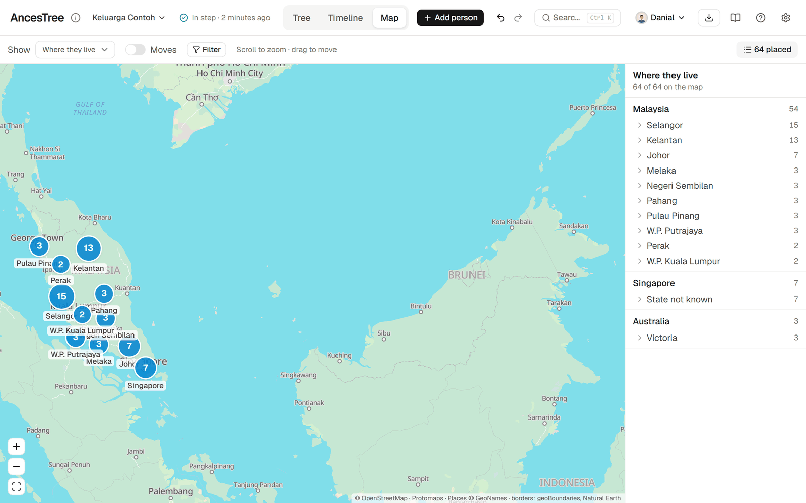

- **Show** chooses **Where they live** or **Where they were born**.
- **Moves** draws a line from where each person was born to where they live.
- Turn the mouse wheel to zoom. Each circle shows how many people are there. Click a circle to zoom in; close up, you see each person's photo in their town.
- Zoom in for more. Once the map's detail is on your computer (below), the map shows the land as OpenStreetMap draws it: towns, kampungs, roads, rivers and districts, each in its own name, with the English beneath where it differs. Without it, and in a view-only copy, the map draws each district and names the towns around your family's places as you zoom in.
- The list on the right counts people by country, state and town, each town with its district: *Kampung Laut, Tumpat* under *Kelantan*. Click a name to see them on the map.
- **Not on the map yet** lists those with no place recorded. Click **Add where they live** to fill it in there and then.

The map's towns and borders come with AncesTree, so it needs no internet for them. It knows every town and kampung in Malaysia, Indonesia, Singapore and Brunei, by its other spellings too, and towns of 1,000 people or more elsewhere. A person's **Lives in** says their district too, where the map knows their town. The map's corner names who made it, OpenStreetMap's contributors first, and **Settings → About** says who made each part, under what licence.

### A town the map doesn't know

- *What it's for:* putting a town on the map by hand, when the map doesn't know it.
- *Who does it:* the keeper.

A town the map doesn't know is placed at the middle of its state or country, under **Placed roughly**.

1. Click **Put it on the map** beside it.
2. Click the right spot on the map.

### The map's detail

- *What it's for:* the land close up, as OpenStreetMap draws it, kept on your computer.
- *Who does it:* everyone, on their own computer.
- *Before you start:* the internet. The world's map is 45 MB; Malaysia, Singapore and Brunei 168 MB; Indonesia 338 MB.

The first time you open the map, AncesTree fetches the world's map from OpenStreetMap by itself, once. For Malaysia, Singapore and Brunei close up, or for Indonesia:

1. Open **Settings → Map**.
2. Click **Fetch** beside the region.

Each is checked before it's used, and kept on your computer, so the map looks nothing up online as you use it. **Remove** takes a region off again.

*Online detail where the packs end:* beyond the packs, such as a town abroad close up, or Indonesia closer than its pack goes, the map is drawn more coarsely. To see those places in detail too, turn on **Online detail where the packs end** in **Settings → Map**. AncesTree then asks OpenFreeMap, a free map service, for those parts of the map as you look at them, so OpenFreeMap learns which parts of the world you look at, from your computer's internet address. It's told nothing about your family, and nothing where a pack has the detail. It's off unless you turn it on; turned off, the map asks nothing of the internet. Without the internet, the map carries on from the packs.

## 14. Family facts, and what's missing

**Family facts** shows the whole family at a glance: how many people and generations, the oldest and youngest, the longest life, the biggest family, the most common names, birthdays and remembrance days this month, and what's still to fill in. Click **Family facts** at the top left. Click a name to open their panel.

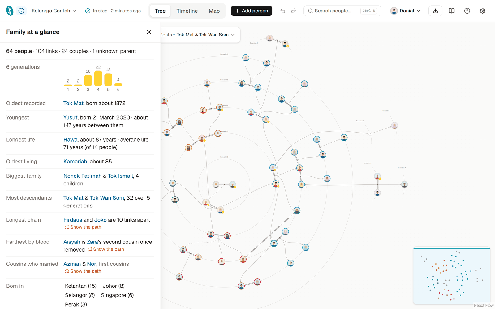

**What's missing** lists what the family's record doesn't say yet, with a quick way to fill in each: genders, dates of birth, birth order, unknown parents, photos, where people live, and people not linked to anyone. Open **Settings → What's missing**. Every fix can be undone.

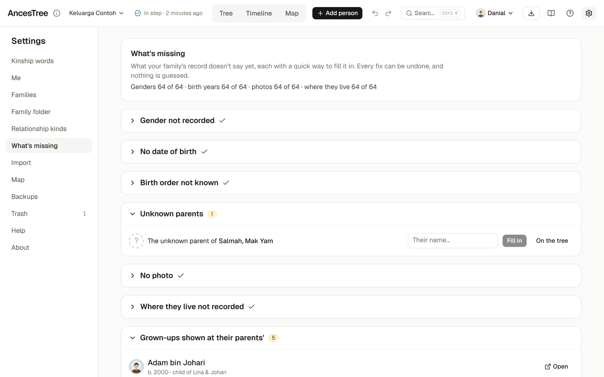

## 15. Kinship words and the dictionary

AncesTree knows the words for relatives in three languages: English, Bahasa Melayu and Basa Jawa.

### Choosing the words

- *What it's for:* the language AncesTree's words for relatives are in, and the titles your family uses for uncles and aunts.
- *Who does it:* everyone, for their own computer. In a family folder, the keeper sets the titles for everyone.

1. Open **Settings → Kinship words**.
2. Choose **English**, **Bahasa Melayu** or **Basa Jawa**. The rest of AncesTree stays in English.
3. Under Malay birth-order titles, check the titles for uncles and aunts by birth order, such as *Long*, *Ngah* and *Lang*, and *Su* for the youngest. Change them if your family says them differently, then click **Save titles**. On a relative's computer, the keeper's titles are shown, not changed.

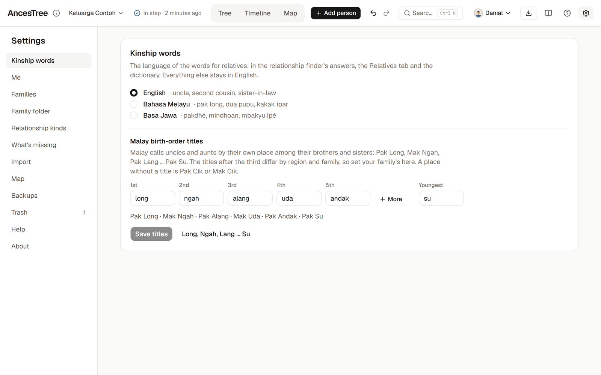

### The dictionary

**Dictionary**, in the top bar, lists every word AncesTree uses for a relative in the three languages, with other words people say. Type in **Search words or relations…** to find one.

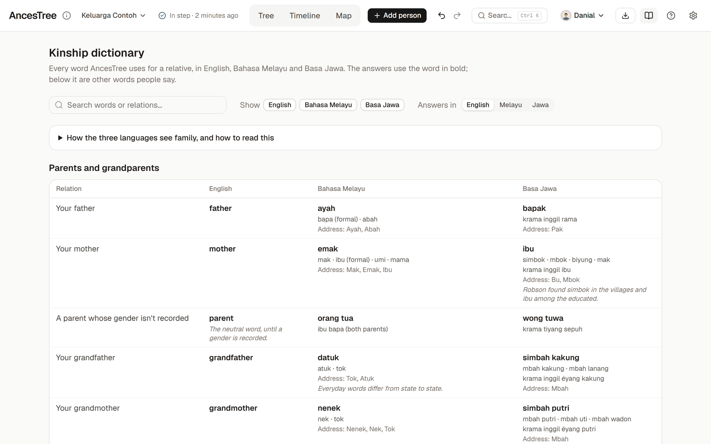

## 16. Copies for phones, and other files

Click **Export** in the top bar.

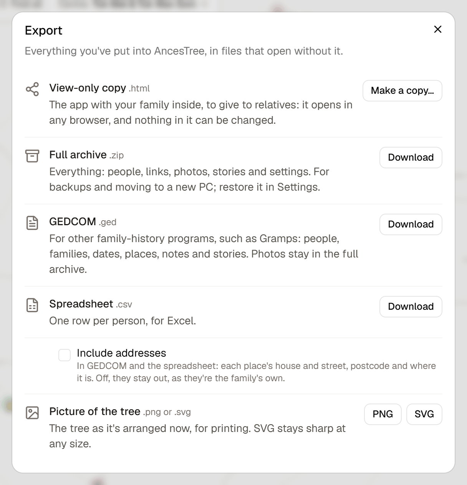

| Choice | What you get |
|---|---|
| **View-only copy** | The whole family in one file, to give to relatives on phones, tablets or computers without AncesTree. It opens in any web browser, and nothing in it can be changed. |
| **Full archive** | Everything: people, links, photos, stories and settings. For moving to another computer. |
| **GEDCOM** | A file for other family-history programs, such as Gramps. |
| **Spreadsheet** | One row per person, for Excel. |
| **Picture of the tree** | The tree as it looks now, to print. **PNG** is a picture; **SVG** stays sharp at any size. |

Files go to your **Downloads** folder.

### A copy for phones

- *What it's for:* the whole family in one file, for relatives on phones, tablets or computers without AncesTree.
- *Who does it:* everyone.

1. Click **Export**, then **Make a copy…** beside **View-only copy**.
2. Give it a **Title**, such as the family's name.
3. For copies that go beyond close family, choose **Hide their details** under **Living people**. Living people's day and month of birth, places, notes and life stories are then left out.
4. If you like, tick **Lock the copy with a password**, and type one. Tell them the password by phone, not with the file.
5. Click **Make the copy**.

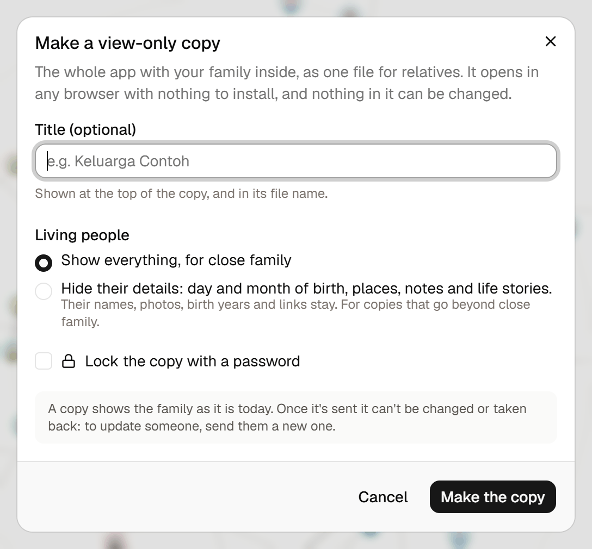

Send the file by WhatsApp, email or a USB stick. A copy is the family as it is today. It never changes; to update someone, send them a new copy.

*If it doesn't work:* on an Android phone, open the file with Chrome. iPhones and iPads can't open it: they show the file without running it.

## 17. Bringing people in from a spreadsheet

- *What it's for:* people from an Excel spreadsheet: a branch a cousin typed up, or corrections.
- *Who does it:* mostly the keeper. On a relative's computer, it waits for the keeper like any change.
- *Before you start:* Excel, or another program that saves CSV files.

1. Open **Settings → Import**.
2. Click **Template (.csv)** to get an empty spreadsheet with the right columns. **Example (.csv)** is the same, filled in with the made-up family.
3. Fill it in with Excel, one row per person. Only **Full name** is needed. Save it as **CSV UTF-8**.
4. Click **Choose a file…**, and choose it.
5. AncesTree shows every change it would make, each with a tick. Untick what you don't want, and answer any questions under **To check**.
6. Click **Import … changes**.

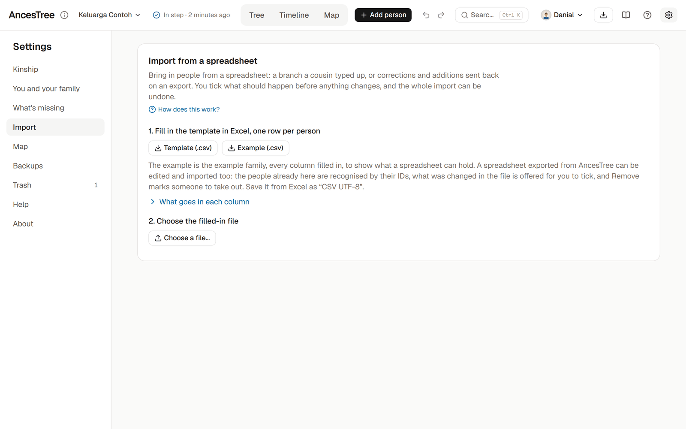

AncesTree makes a backup first. **Undo** takes the whole import back. Later, **Take back…** under **Earlier imports** does the same.

---

# Part 3: The family folder

The family folder keeps every family computer in step, through a private folder in the keeper's Google Drive:

- the keeper's changes reach every relative's computer by themselves, photos and stories too;
- a relative's changes go to the keeper, who looks at each before it reaches everyone else;
- everything in Google Drive is locked on the family's computers first. Google keeps the files, but can't read them.

AncesTree reaches Google Drive through *the family's Google project*: the keeper's own, set up once (see [Your family's Google project](#your-familys-google-project)). Nothing of one family goes through another's project, or through AncesTree's maintainer.

AncesTree must be running for the family to keep in step. It runs by the clock, so leave it there. A family kept on one computer alone needs none of this part.

The pictures in this part show the made-up family too: its Google accounts, computer names, codes and invitation are all made up. Yours appear in their place.

### Keeping in step

At the top of the window, beside the family's name, AncesTree says how the family stands with its family folder:

| It says | What it means |
|---|---|
| **In step** · 2 minutes ago | All's well: the family is in step with everyone's. |
| **Keeping in step…** | AncesTree is keeping in step just now. |
| **Offline** · in step 3 hours ago | There's no internet. AncesTree tries again every minute. |
| **Not in step since** Tue 1 Oct | Nothing has gone through for over a day. Click it to see why. |
| **Sign in to Google** | The sign-in has ended. Open **Settings → Family folder**, and sign in again. |
| **Family folder gone**, or **Not in step** | Something's in the way. Click it to see what. |

Click it to see when the family was last in step; when it last arrived, on a relative's computer, or when your last change went out, on the keeper's; and what waits. **Sync now** keeps in step at once.

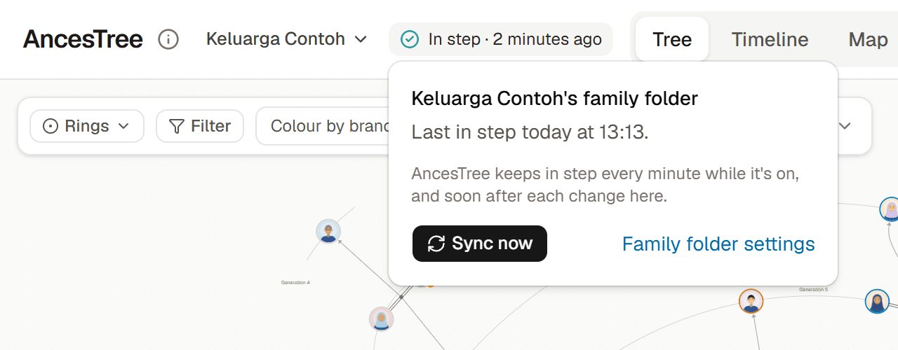

The icon by the clock says the same when you point at it, and its menu has **Sync now** too.

AncesTree keeps in step every minute while it runs, a few seconds after each change you make, when you come back to its window, and once more before it closes.

### Signing in to Google

- *What it's for:* letting AncesTree reach the family folder in Google Drive.
- *Who does it:* everyone in a family folder, once on each computer: relatives with the account the keeper invited, and the keeper with the account that holds the family folder.
- *Before you start:* the Google account, and its password.

1. Open **Settings → Family folder**, and click **Sign in with Google**. Google's page opens in your web browser.

   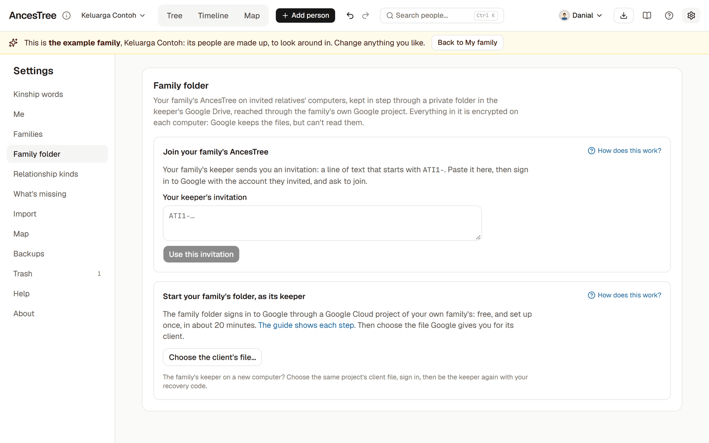

2. Choose your Google account. A relative chooses the account their keeper invited.
3. Google says **Google hasn't verified this app**. The family's Google project is the keeper's own, and Google hasn't checked it, as it's for one family. Click **Advanced**, then **Go to AncesTree (unsafe)**. If your keeper gave their project another name, it shows that name instead.
   <!-- picture: guide/google-1-not-verified.png (Google hasn't verified this app) -->
   <!-- picture: guide/google-2-advanced.png (the same after Advanced, with Go to AncesTree (unsafe)) -->
4. Google asks what AncesTree may do. Tick both boxes, then click **Continue**:
   - seeing your Google Drive's files, so that AncesTree can find the family folder;
   - changing only the files AncesTree itself makes.

   AncesTree only ever looks in the family's folder, and in a small folder it makes for what a relative sends the keeper.
   <!-- picture: guide/google-3-access.png (what AncesTree may do, both boxes ticked) -->
5. The page says **Done. You can close this tab and go back to AncesTree.** Close the tab, and go back to AncesTree.
   <!-- picture: guide/google-4-done.png (Done. You can close this tab) -->

*If it doesn't work:*

- **Both boxes need ticking on Google's page**: sign in again, and tick both boxes.
- AncesTree says **That was …**, and that this computer's family folder is with another account: you signed in with another Google account. Sign in again, and on Google's page choose the account it names. If your browser keeps choosing the other one, see [When something goes wrong](#25-when-something-goes-wrong).

## 18. For relatives: join your family

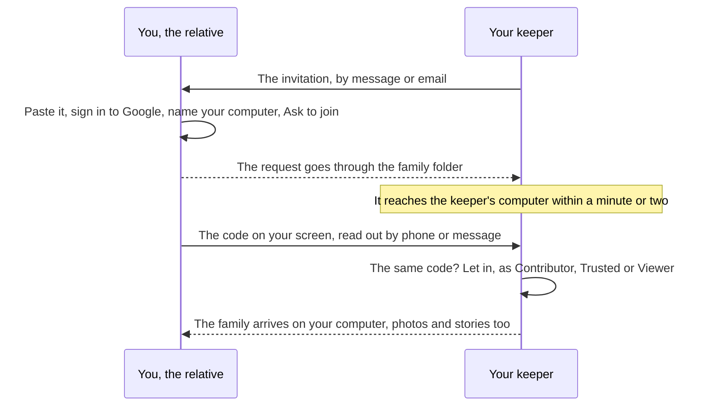

### Join

- *What it's for:* joining your family's AncesTree: the family arrives on your computer, and keeps in step.
- *Who does it:* a relative the keeper invited, or the keeper on another computer of their own (see [Your own other computers](#your-own-other-computers)).
- *Before you start:*
  - AncesTree installed (see [Install AncesTree](#2-install-ancestree));
  - your keeper's message with the invitation: a line of text that starts with `ATI1-`, among a few lines on installing AncesTree;
  - the Google account your keeper invited. Your keeper shares the family folder with it; Google doesn't tell you when they have, so they'll tell you;
  - your keeper on the phone, or able to message you, for step 6.

1. AncesTree says **Welcome to AncesTree**. Click **Join or start**. Or open **Settings → Family folder**.
   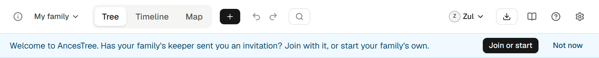
2. Copy your keeper's whole message: AncesTree finds the invitation in it. In most message apps, press and hold the message, or right-click it, and choose to copy it.
3. Under **Join your family's AncesTree**, click in the box, press **Ctrl+V**, and click **Use this invitation**.
   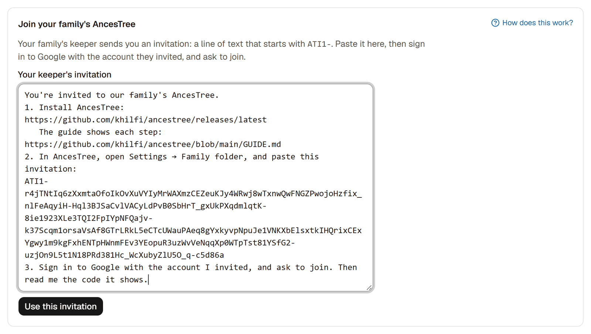
4. Sign in to Google with the account your keeper invited (see [Signing in to Google](#signing-in-to-google)).
5. Type a name for this computer, such as *Mak Long's laptop*. The family sees this name. Click **Ask to join**.
   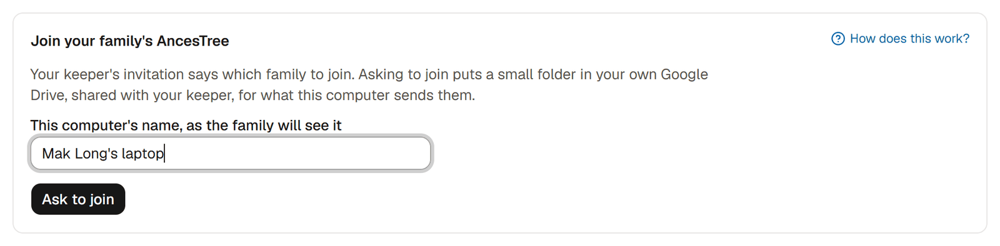
6. AncesTree shows **Waiting to be let in**, with a code of eight letters and numbers. Read the code to your keeper, by phone or message. They let your computer in only if theirs shows the same code.
   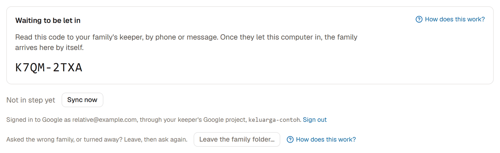
7. Once your keeper lets you in, the family arrives by itself, photos and stories too. Leave AncesTree running: with many photos, it can take a while. Meanwhile it says **Photos and stories are still arriving**.

If you had already put people into AncesTree yourself, the family replaces them on this computer. What you had is kept in a backup, under **Settings → Backups**: send it to your keeper if it should join the family. Or keep it as a family of its own (see [Several families on one computer](#21-several-families-on-one-computer)).

*If it doesn't work:*

- **That isn't an AncesTree invitation**, or **That invitation isn't whole**: copy the whole message again, from its first line to its last, and paste it again.
- **The family folder isn't shared with … yet**: your keeper hasn't shared it with that Google account. Check that you signed in with the account they invited. If you did, ask them to invite it, then click **Ask to join** again.
- Your keeper sees nothing to let in: your request reaches their computer through the family folder, within a minute or two of you asking. Their **Sync now** fetches it at once.
- You asked to join the wrong family, or your keeper turned your computer away by mistake: click **Leave the family folder…** under **Waiting to be let in**, then join again.

### What your computer may do

Your keeper chooses one of these when letting your computer in, and can change it later:

| Role | What it means |
|---|---|
| **Contributor** | You change the family as you like. Each change waits for your keeper, who looks at it first. |
| **Trusted** | Your changes come in by themselves, unless they clash with your keeper's or take something out. |
| **Viewer** | You see the whole family, but can't change it on this computer. |

What happens to a change, on each kind of computer:

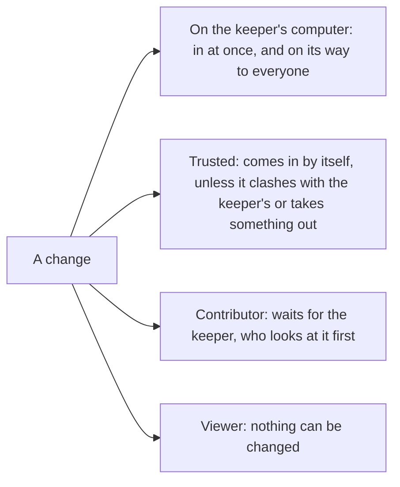

Some things are the keeper's alone, whatever your role: the kinds of relationship, the map's hand-placed pins, importing spreadsheets, and restoring a backup.

When your keeper changes your computer's role, **Settings** shows a number, and **Settings → Family folder** says **Your keeper changed what this computer may do**. Click **Got it** when you've read it. If it becomes a **Viewer** while you have changes of your own, AncesTree keeps them in a backup first (see **Settings → Backups**), then shows the family as your keeper keeps it.

### Your changes

When you change something, the bar at the top says how many of your changes wait for your keeper. AncesTree sends them by itself within a few seconds. **Send now** sends them at once.

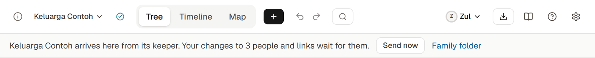

Your keeper sees them the next time their AncesTree is running. When they bring your changes in, those reach every computer in the family, yours too:

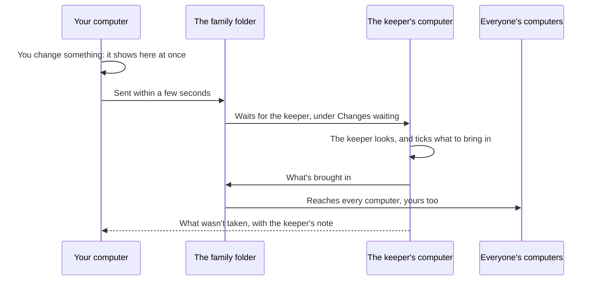

### Your keeper's answer

When your keeper leaves something out, or writes you a note, **Settings** shows a number, and **Settings → Family folder** shows **The keeper's answer**: their note, and what wasn't taken. What wasn't taken goes from your computer. Click **Got it** when you've read it.

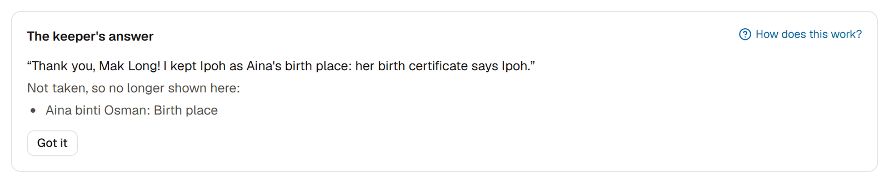

### When your keeper moves the family folder

If your keeper makes the family folder again, or moves it to another Google account, your computer finds it and carries on by itself.

If they move it to another Google project, AncesTree asks for your keeper's newest invitation:

1. In **Settings → Family folder**, click **Your keeper sent a new invitation?**.
2. Paste the new invitation, and click **Use this invitation**.
3. AncesTree shows the new project's name, and asks first. Click **Move, and sign in again** if your keeper told you they're moving the family, then sign in again.

An invitation your keeper didn't sign can't move your computer.

### When your keeper asks you to keep the family

Your keeper can hand the family to you. **Settings** shows a number, and **Settings → Family folder** says your keeper asks you to keep the family, and what that means: you look at relatives' changes and let computers in, the family folder moves to your Google Drive, and you get a recovery code to keep safe.

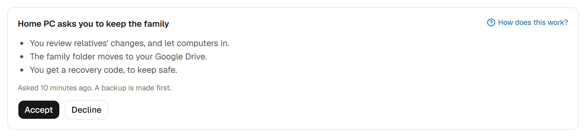

Click **Accept** to keep it, or **Decline**. Accepting makes a backup first, then shows your recovery code: write it down, and keep it safe (see [Start the family folder](#start-the-family-folder), step 4).

### Leaving the family

- *What it's for:* taking this computer out of the family folder. The family stays on it as it is, as your own: nothing new arrives, and nothing you change goes to the keeper.
- *Who does it:* a relative, on their own computer.

1. Ask your keeper to remove your computer (see [Remove a computer](#remove-a-computer)).
2. On your computer, open **Settings → Family folder**, and click **Leave the family folder…**.
3. Click **Leave**.

You can ask to join again later, with an invitation.

## 19. For the keeper: start and look after the family folder

- *What it's for:* the family's AncesTree on several computers, kept in step through a folder in your Google Drive, with you looking at each relative's change before it reaches everyone.
- *Who does it:* the keeper.
- *Before you start:*
  - *bring your family in first*, before you start the family folder: it sends the family as it is. If your family is in another AncesTree, such as on your old computer, move it across first (see [Moving the family to another computer](#moving-the-family-to-another-computer)). A family you'll type in yourself can start empty;
  - *choose the Google account carefully*: the family folder lives in its Drive, and you'll need this same account to keep the family on another computer;
  - *allow about 20 minutes* the first time, for the Google project;
  - *a pen and paper, or a printer*, for your recovery code.

The first day, in order:

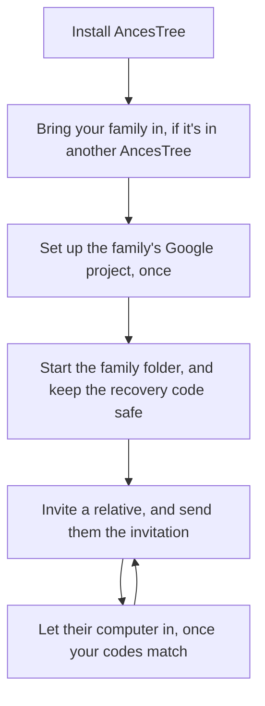

### Your family's Google project

- *What it's for:* the way your family's computers reach Google Drive: a Google Cloud project of your own, free, set up once. Your relatives sign in through it, and nothing of your family goes through anyone else's.
- *Who does it:* the keeper, once.
- *Before you start:* the Google account that will hold the family folder, in your web browser on your computer.

1. Open the Google Cloud console, [console.cloud.google.com](https://console.cloud.google.com), and sign in with the Google account that will hold the family folder. The first time, agree to Google's terms.
   <!-- picture: guide/project-1-console.png (the Google Cloud console, the first time) -->
2. Make a project. Click the project list at the top, then **New project**. Name it, for example *AncesTree Keluarga Rahman*, and click **Create**. Check that it's chosen in the project list.
   <!-- picture: guide/project-2-new.png (New project, named) -->
3. Switch on Google Drive's API. Open the menu (**☰**), then **APIs & Services → Library**. Search for **Google Drive API**, click it, then click **Enable**.
   <!-- picture: guide/project-3-drive-api.png (Google Drive API, with Enable) -->
4. Describe AncesTree to Google. Open the menu, then **Google Auth platform**, and click **Get started**:
   - **App name**: *AncesTree*. Your relatives see this name when they sign in;
   - **User support email**: your own. Click **Next**;
   - **Audience**: **External**. Click **Next**;
   - **Contact information**: your email again. Click **Next**;
   - tick that you agree to Google's API Services User Data Policy, then click **Continue**, and **Create**.
   <!-- picture: guide/project-4-branding.png (Google Auth platform: App name, User support email) -->
5. Say what AncesTree may do. Under **Google Auth platform**, open **Data Access**, and click **Add or remove scopes**. Tick these two, or paste them under **Manually add scopes**:
   - `https://www.googleapis.com/auth/drive.readonly`
   - `https://www.googleapis.com/auth/drive.file`

   Click **Update**, then **Save**.
   <!-- picture: guide/project-5-scopes.png (Data Access, the two scopes added) -->
6. Put it in production. Open **Audience**, and under **Publishing status**, click **Publish app**, then **Confirm**. Without this, each sign-in ends after a week. Google doesn't need to verify it: it's for your family alone, and up to 100 people can sign in through it.
   <!-- picture: guide/project-6-publish.png (Audience: In production) -->
7. Make its client. Open **Clients**, and click **Create client**. For **Application type**, choose **Desktop app**. Name it *AncesTree*, and click **Create**. Then click **Download JSON**: the client's file goes to your **Downloads** folder.
   <!-- picture: guide/project-7-client.png (the client made, with Download JSON) -->
8. Give it to AncesTree. Open **Settings → Family folder**. Under **Start your family's folder, as its keeper**, click **Choose the client's file…**, and choose the file you downloaded. AncesTree keeps it with this family, locked.

   

Keep the client's file somewhere safe, as you keep your recovery code: you'll need it to be the keeper again on a new computer. It isn't your Google password, but share it only with your family: your invitations carry it to them. If it's lost, make another client in the same project.

*If it doesn't work:*

- If a page in Google's console says something other than these steps do, follow what it says: Google changes its console from time to time.
- **That client is for a web application**: in your Google project, make a client of the **Desktop app** type, and choose its file.

### Start the family folder

- *What it's for:* the family folder itself, in your Google Drive, with your family in it, ready to invite relatives.
- *Who does it:* the keeper, once.
- *Before you start:* your family in this AncesTree (see the start of this section), the client's file chosen (above), and a pen and paper or a printer.

1. Sign in to Google with the account that will hold the family folder (see [Signing in to Google](#signing-in-to-google)).
2. Under **Start your family's folder, as its keeper**, type the family's name, such as *Keluarga Rahman*, and this computer's name, such as *Home PC*.
3. Click **Start the family folder**.
   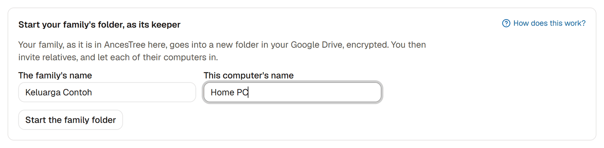
4. AncesTree shows your recovery code. With it, the client's file and this Google account, you can be the family's keeper again on another computer. Without it, no one can.
   - Click **Print**, or write the code down. Keep it somewhere safe, away from this computer: with your important papers, or in your password manager.
   - Leave a copy with someone you trust, in a sealed envelope: if yours is lost with your computer, theirs lets you be the keeper again on a new one. The family can't be handed over from a computer that's gone; only the code brings it back.
   - When it's safe, click **I've kept it safe**. AncesTree shows the code until you do, then never again.
   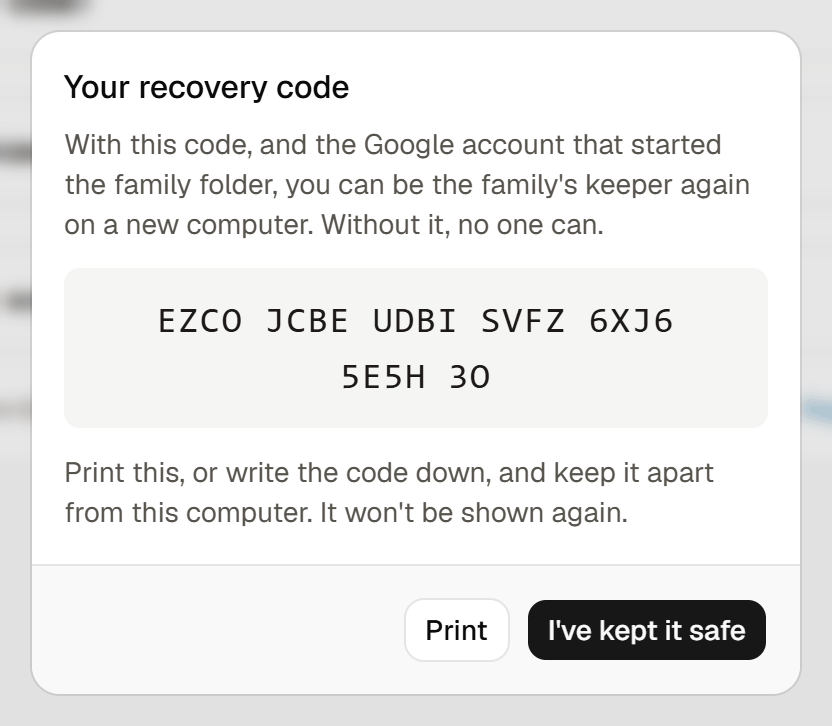

*If AncesTree says **Your Google Drive holds a family folder already**:* that Google account holds a family folder from before. Which is it?

| The folder in your Drive is | Do this |
|---|---|
| This family's, from when you kept it on another computer | Click **Cancel**. Don't start another: be its keeper again with your recovery code (see [Be the keeper on a new computer](#be-the-keeper-on-a-new-computer)). |
| Another family's, such as the other side of yours | Click **Start another family's folder**. One Google account can hold several families' folders. |
| You're not sure | Click **Cancel**, and look in your Google Drive: each family folder is named after its family. |

*Lost your recovery code, or someone else may have seen it?* In **Settings → Family folder**, click **Lost your recovery code?**, then **Make a new recovery code**, and **Make it**. Keep the new code as you kept the old. Once it's in your Google Drive, the old code opens nothing.

### Invite a relative

- *What it's for:* sending a relative what their AncesTree needs to join your family.
- *Who does it:* the keeper.
- *Before you start:* the relative's Google account: the address they sign in to Google with.

1. In **Settings → Family folder**, under **Invite a relative, by their Google account**, type their Google address, and click **Invite**. AncesTree shares the family folder with that account.
2. AncesTree shows **The invitation to send**: a few lines on installing AncesTree, then the invitation, a long line starting with `ATI1-`. Click **Copy**: it copies all of it.
   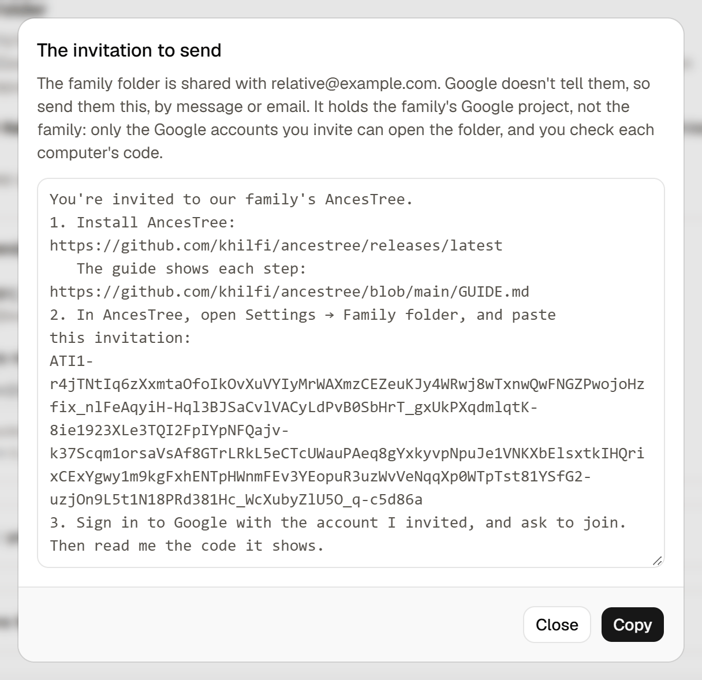
3. Paste it into a message or an email to them, with **Ctrl+V**, and send it. Send all of it, as it is: the invitation is long, and a part of it is no use.
4. Ask them to follow [Join your family](#18-for-relatives-join-your-family), and to call or message you when AncesTree shows them a code.

The invitation holds your family's Google project, not your family: only the Google accounts you invite can open the family folder, and you check each computer's code. Send it only to family. To send it again, click **Show the invitation**, under the family's computers.

*If it doesn't work:* if **Copy** says it couldn't copy, click in the invitation's box, press **Ctrl+A** to choose all of it, then **Ctrl+C** to copy it.

### Your own other computers

- *What it's for:* the family on another computer of your own, such as a laptop or a Mac, kept in step with your main one.
- *Who does it:* the keeper, on both computers.
- *Before you start:* AncesTree installed on the other computer.

Your other computer joins much as a relative's does, but it isn't a relative's:

| | A relative's computer | Another computer of your own |
|---|---|---|
| Its Google account | Theirs, which you invite with **Invite** | Your own: no need to invite it |
| The invitation | You send it to them | On your main computer, click **Show the invitation**, and copy it across |
| What you let it in as | **Contributor** is a good start | **Trusted**: what you change there comes in by itself |

1. On your main computer, in **Settings → Family folder**, click **Show the invitation**, and **Copy**. Send it to yourself, by email or a message you can open on the other computer.
2. On the other computer, follow [Join](#join): paste the invitation, sign in with your own Google account, name the computer, and click **Ask to join**.
3. On your main computer, open **Settings → Family folder**. The request reaches it through the family folder: there's nothing to click until it has, and that can take a minute or two. To fetch it at once, click **Sync now**.
4. Under **Asking to join**, check the code against the other computer's, choose **Trusted**, and click **Let in** (see [Let their computer in](#let-their-computer-in)).

Don't use **Be the keeper again** on your other computer: only one computer keeps the family.

### Let their computer in

- *What it's for:* letting a relative's computer into the family, once you know it's theirs.
- *Who does it:* the keeper.
- *Before you start:* the relative has asked to join, and you can call or message them.

When a relative asks to join, **Settings** shows a number, and **Settings → Family folder** shows their computer under **Asking to join**, with a code. Their request reaches your computer through the family folder, within a minute or two of them asking: **Sync now** fetches it at once.

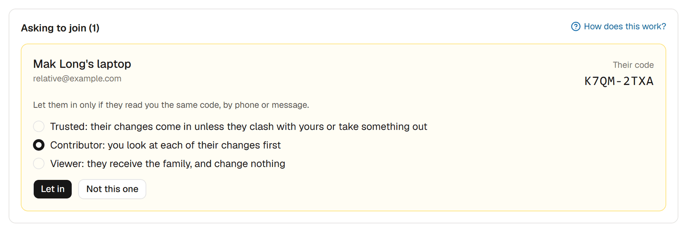

1. Call or message them, and ask them to read you the code on their screen.
2. Let them in only if it's the same code. If it isn't, click **Not this one**, and find out why.
3. Choose what their computer may do: **Trusted**, **Contributor** or **Viewer** (see [What your computer may do](#what-your-computer-may-do)). **Contributor** is a good start: you look at each change first.
4. Click **Let in**.

The family reaches their computer within a few minutes, photos and stories too.

*If it doesn't work:* if you turned a computer away by mistake, its owner leaves and asks to join again (see [Join](#join), *If it doesn't work*).

### Changes waiting

- *What it's for:* looking at what a relative changed, and bringing in what you want of it.
- *Who does it:* the keeper.

When a relative changes something, it waits for you, and **Settings** shows a number.

1. Open **Settings → Family folder**. Under **Changes waiting**, click **Review** beside their computer.
   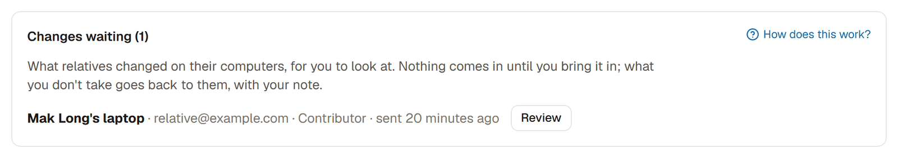
2. Each change has a tick. Untick what you don't want.
   - A change that clashes with one of yours, or that takes something out, waits for its own tick.
   - Under **To check**, AncesTree asks whether someone new is someone already in the family.
3. Write a note, if you like. It goes back to them with whatever you don't take.
4. Click **Bring in … changes**. Or **Take none**, to send everything back with your note. **Not now** leaves it for later.
   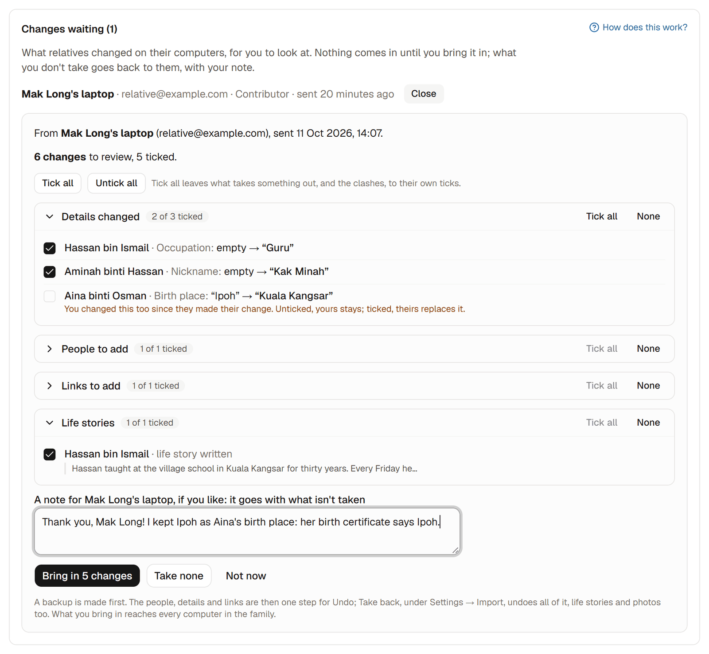

Before anything comes in, AncesTree makes a backup. **Undo** takes back the people, details and links. **Settings → Import** keeps each bringing-in under **Earlier imports**; its **Take back…** undoes all of it, life stories and photos too. What you bring in reaches every computer in the family.

A **Trusted** computer's changes come in by themselves, unless they clash with yours, take something out, or need an answer under **To check**.

*If it doesn't work:* if what they sent can't be read on your computer, the review says so: click **Take none**. They hear that none of it was taken, and can make their changes again.

### Change what a computer may do

- *What it's for:* giving a relative's computer another role: **Trusted**, **Contributor** or **Viewer**.
- *Who does it:* the keeper.

1. In **Settings → Family folder**, under **The family's computers**, click **Change role…** beside it.
2. Choose **Trusted**, **Contributor** or **Viewer** (see [What your computer may do](#what-your-computer-may-do)).
3. Click **Change**.

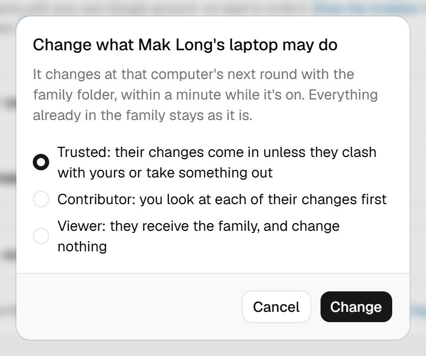

Their computer changes within a minute while it's on, and tells them.

*If it doesn't work:* if their changes are waiting for you, **Change** waits until you've reviewed them (see [Changes waiting](#changes-waiting)), so nothing comes in, or goes, without you seeing it.

### Remove a computer

- *What it's for:* stopping a computer from getting anything new of the family: one that's lost, sold, or no longer the family's.
- *Who does it:* the keeper.

1. In **Settings → Family folder**, under **The family's computers**, click **Remove** beside it.
2. Click **Remove** again.

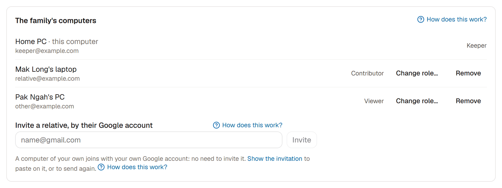

AncesTree stops sharing the family folder with that Google account, and gives the family a new key. That computer keeps what it already has, but can't read anything new.

### Hand the family to someone else

- *What it's for:* another of the family's computers keeping the family instead of yours: a relative's, or another computer of your own.
- *Who does it:* the keeper.
- *Before you start:* their computer has joined the family, as any relative's does, and has the newest AncesTree.

1. In **Settings → Family folder**, open **Hand the family to someone else?**, and click **Hand the family to someone else…**.
2. Choose their computer, and what yours becomes afterwards: **Trusted**, **Contributor**, **Viewer**, or **Leave the family**.
3. Click **Offer it**.
   

Until they answer, nothing changes on your computer, and you can click **Withdraw the offer**.

When they accept, the family folder moves to their Google Drive, and your computer carries on as you chose. Handed to a computer of your own, the family folder stays where it is, and so does your recovery code. Your family signs in to Google through your Google Cloud project: add them as an **Owner** of it in the Google Cloud console (**IAM & Admin → IAM → Grant access**), so the family no longer depends on your Google account.

*If it doesn't work:* if something is in the way, AncesTree says what: changes waiting for you, say, or their computer still to update itself.

### Be the keeper on a new computer

- *What it's for:* keeping the family on a new computer, when your old one is lost, broken or replaced.
- *Who does it:* the keeper.
- *Before you start:* your recovery code, the client's file (see [Your family's Google project](#your-familys-google-project)), and the Google account that holds the family folder.

1. Install AncesTree on the new computer.
2. Open **Settings → Family folder**, click **Choose the client's file…**, and choose your family's Google project's client file.
3. Sign in with the Google account that holds the family folder.
4. Click **The family's keeper, on a new computer?**, type your recovery code, and click **Be the keeper again**.

The family comes back from the family folder. If your Google account holds several families' folders, the code finds its own. If photos and stories are still arriving, AncesTree says so, and waits for them before it sends anything.

The old computer, if it still runs, stops keeping the family by itself: its **Settings → Family folder** says **Another computer keeps the family now**. Click **Leave the family folder…** there, then **Leave**, or [remove AncesTree](#26-removing-ancestree) from it.

*If it doesn't work:* **That recovery code doesn't open …**: check the code, and that you signed in with the account that holds the family folder. Spaces and capitals don't matter. If you made a new code since, only the new one works.

### When the family folder is lost: rebuild it

- *What it's for:* a new family folder, made from your computer, when the old one is gone: deleted from Google Drive past its bin's 30 days, or in a Google account that's lost.
- *Who does it:* the keeper.

Your computer still has every one of the family folder's files.

1. Open **Settings → Family folder**. It says **The family folder is gone from Google Drive**.
2. Click **Rebuild the family folder**, then **Rebuild it**.

A new family folder is made from this computer, with the same family, keys and history, and shared again with each relative's Google account. Their computers find it and carry on by themselves: nobody joins again.

*If it doesn't work:* if the old folder is only in Google Drive's bin, take it out there instead of rebuilding.

### Move the family folder

- *What it's for:* keeping the family folder in another Google account, or reaching it through another Google project.
- *Who does it:* the keeper.

1. Open **Settings → Family folder**, and click **Move the family folder to another Google account or project?**.
2. Click **Another Google account…**, and sign in with that account in your browser. Or click **Another Google project's client file…**, choose the new project's client file, and sign in.
3. Click **Rebuild it here**.

The old folder goes to Google Drive's bin, and relatives' computers follow the new one. After a move to another Google project, send relatives the new invitation (**Show the invitation**): their AncesTree asks for it.

*If it doesn't work:* if AncesTree can't put the old folder in the bin, it says so: delete it in Google Drive yourself, then click **I've deleted it**.

### Copies for those without AncesTree

For relatives on phones or tablets, or anyone who won't install AncesTree, make a [view-only copy](#a-copy-for-phones).

---

# Part 4: Look after AncesTree

## 20. Backups

A backup holds everything: people, links, photos, stories and settings. AncesTree makes one each day by itself while it runs, and keeps the last 30. Backups you make yourself are kept until you delete them.

Open **Settings → Backups** to see them all.

| To | Do this |
|---|---|
| Make a backup now | Click **Back up now**. |
| Copy a backup somewhere safe | Keep copies in another place (below), or click the download arrow beside one: it goes to your **Downloads** folder. |
| Check a backup | Click the double tick beside it. AncesTree reads all of it, every file against its checksum, and restores nothing. |
| Bring in a backup from elsewhere | Click **Add a backup file…**, and choose the file. A locked copy asks for its password. |
| Go back to a backup | Click **Restore…** beside it, then **Replace everything**. |

Restoring replaces everything in the family with what the backup holds. Everything as it is just before is backed up first, so you can always go back. A backup of another family on this computer can't be restored into this one.

On a relative's computer, restoring is the keeper's alone: the family comes from the family folder.

### Copies in another place

- *What it's for:* copies of the backups away from this computer's own disk, so that losing the computer doesn't lose them too.
- *Who does it:* the keeper, and anyone keeping a family on one computer.
- *Before you start:* a USB stick or disk, or a folder that OneDrive, Dropbox or Google Drive keeps; and a password to lock the copies with.

1. In **Settings → Backups**, under **Copies in another place**, click **Choose a place…**.
2. Choose a place AncesTree found, such as a USB stick or OneDrive's folder. Or choose **Another folder**, and type where it is, such as `E:\AncesTree backups`.
3. **Lock the copies with a password** is ticked. Keep it so, above all for a folder OneDrive, Dropbox or Google Drive keeps: anyone who gets a copy then can't read it. Type a password twice. AncesTree doesn't keep it, so keep it with your recovery code.
4. Click **Copy them there**.

From then on, each backup is copied there as it's made, into a folder named `AncesTree` and the family's id. The last 30 daily copies are kept, as the backups are, and copies of the backups you made yourself for good.

To bring a copy back: **Add a backup file…**, choose it, and type its password if it's locked.

*If it doesn't work:* when the place isn't there, a USB stick taken out say, Settings says **… can't be reached: is its disk plugged in?**. Plug it in: the copies catch up by themselves.

### Moving the family to another computer

- *What it's for:* the family on a new computer, from your old one.
- *Who does it:* everyone, in their own way, below.

- *The keeper, with a family folder:* see [Be the keeper on a new computer](#be-the-keeper-on-a-new-computer). The family comes from the family folder.
- *A relative:* install AncesTree on the new computer and [join](#18-for-relatives-join-your-family) again, with the invitation. Ask your keeper to remove your old computer.
- *Anyone without a family folder:*
  1. On the old computer, open **Settings → Backups**, click **Back up now**, then the download arrow beside the new backup. Copy the file to a USB stick.
  2. On the new computer, install AncesTree, open **Settings → Backups**, click **Add a backup file…**, and choose the file from the USB stick.
  3. Click **Restore…** beside it, then **Replace everything**.

  Or, on the new computer, click the family's name at the top, then **Add a family…** and **Add one from a backup…**: the family opens with the backup restored.

### When something is lost

Which way to go, by what's lost:

| What's lost | What to do |
|---|---|
| A relative's computer | On another computer, install AncesTree, paste the invitation, and ask to join. The keeper lets it in. |
| The keeper's computer | On another computer, give AncesTree the family's Google project's file, sign in, and **Be the keeper again** with the recovery code. |
| The family folder in Google Drive | On the keeper's computer, **Rebuild the family folder**. Relatives' computers follow it. |
| The keeper's computer, and the family folder | On another computer, restore the newest backup: a copy kept in another place, or one a relative makes and sends you. Then start a new family folder, and invite everyone again. Relatives leave the old family folder, and join with the new invitation. |
| The family's Google project | Set up a new one, then [move the family folder](#move-the-family-folder) into it. Relatives paste the new invitation. |
| The recovery code | On the keeper's computer, **Make a new recovery code**. |
| A change brought in by mistake | **Undo**, or **Take back…** under **Earlier imports**. Or restore an earlier backup on the keeper's computer: it reaches everyone. |

## 21. Several families on one computer

AncesTree can keep several families on one computer, such as your mother's side and your father's. Each is completely apart: its own people, photos, stories, backups and family folder. Nothing of one ever shows in another.

### Adding a family

- *What it's for:* another family on this computer, kept apart from the first.
- *Who does it:* everyone.

1. Click the family's name at the top left of the window.
2. Click **Add a family…**.
3. Type its name, and click **Add and open it**. Or click **Add one from a backup…**: it opens with the backup restored.

- Opening another family takes a few seconds: AncesTree keeps the open one in step once more, closes it, and opens the other. Undo starts afresh.
- Only the open family keeps in step with its family folder. The others catch up when you open them, and relatives' changes wait for you meanwhile.
- Each family has its own family folder, or none. You can keep one family, and be a relative in another, each with its own invitation and Google account.

**Settings → Families** lists them all:

| To | Do this |
|---|---|
| Open one | Click **Open** beside it. |
| Rename one | Click **Rename…**. Only this computer sees the name. |
| Remove one from this computer | Click **Remove…**, then **Remove**. It goes to AncesTree's bin for 30 days, then it's deleted. The family that's open can't be removed: open another first. |
| Bring one back | Under **In AncesTree's bin**, click **Put back** beside it. |

If you keep a family's family folder, removing it from this computer means nothing you change reaches relatives, and their changes wait. With your recovery code, you can be its keeper again on another computer.

## 22. Updates

AncesTree updates itself, and installs only updates signed by its maintainer:

- *What it's for:* AncesTree's newest version on your computer.
- *Who does it:* AncesTree, by itself. You only choose when.

1. When there's a new version, a bar at the top says **A new version of AncesTree is ready**. Click **What's new** to see what it brings.
2. Click **Restart to update**. Or carry on: it updates itself the next time AncesTree starts.

To look for a new version yourself, right-click the icon by the clock and choose **Check for updates**. Or open **Settings → About** and click **Check for updates**.

## 23. Keep your computer safe

- *What it's for:* keeping your family safe if someone gets hold of your computer. The family folder in Google Drive is locked, but on each computer the family is kept as it is: anyone who has your computer can read it, unless its disk is locked.
- *Who does it:* everyone, on their own computer. Many new computers lock the disk already.
- *Before you start:* a safe place for the recovery key your computer gives you.

To check, and to switch it on:

- *Windows 11 Home:* click **Start**, then **Settings → Privacy & security → Device encryption**, and switch it **On**. If it isn't there, your computer can't do it.
- *Windows 10 or 11 Pro:* click **Start**, type **Manage BitLocker**, open it, and click **Turn on BitLocker**.
- *Mac:* open **System Settings → Privacy & Security → FileVault**, and click **Turn On**.

When you switch it on, you're given a recovery key. Keep it as safely as the keeper's recovery code: without it, a forgotten password loses everything on the computer.

Give your computer a password too, so that no one else can sign in to it.

## 24. Where AncesTree keeps the family

AncesTree keeps everything in one folder:

| Your computer | The folder |
|---|---|
| Windows | `%LOCALAPPDATA%\app.ancestree.desktop` |
| Mac | `~/Library/Application Support/app.ancestree.desktop` |

To open it on Windows, copy its name into the address bar of File Explorer and press **Enter**. On a Mac, in Finder, choose **Go → Go to Folder…**, paste its name and press **Return**.

Inside it:

- `family`, `backups` and `neo4j`: the first family's photos, life stories and settings; its backups; and its database;
- `families`: each family added since, in a folder of its own, with the same three inside;
- `removed`: families removed from this computer, for 30 days;
- `families.json`: the list of the families, and which one is open;
- `logs`: notes AncesTree keeps of what it did. If something goes wrong, your keeper may ask for this folder.

**Settings → About** shows where the open family's folders are.

## 25. When something goes wrong

| What you see | What to do |
|---|---|
| **AncesTree needs the internet this once, to fetch its database** | Connect to the internet. AncesTree tries again by itself. |
| **AncesTree's engine stopped**, or **Can't reach the database** | Right-click the icon by the clock and choose **Quit AncesTree**. Then open AncesTree again. Nothing is lost: your family is safe on the disk. If it happens again, send your keeper the `logs` folder (see [Where AncesTree keeps the family](#24-where-ancestree-keeps-the-family)). |
| The window has gone | AncesTree is still running. Click its icon by the clock. On a Mac, you can also click AncesTree in the Dock. |
| No icon by the clock | On Windows, click the small **^** arrow beside the clock: the icon may be hidden there. If it isn't, AncesTree isn't running: open it from **Start** (Windows) or **Applications** (Mac). |
| **That isn't an AncesTree invitation**, or **That invitation isn't whole** | Copy your keeper's whole message again, from its first line to its last, and paste it again. |
| **The family folder isn't shared with … yet** | Check that you signed in with the account your keeper invited. If you did, ask your keeper to invite it, then click **Ask to join** again. |
| **This family has no Google project to sign in through yet** | A relative: paste your keeper's invitation. The keeper: choose your project's client file (see [Your family's Google project](#your-familys-google-project)). |
| **Your family's Google project has changed** | Ask your keeper for their newest invitation. Paste it under **Your keeper sent a new invitation?**, then sign in again. |
| **That client is for a web application** (the keeper) | In your Google project, make a client of the **Desktop app** type, and choose its file. |
| **Both boxes need ticking on Google's page** | Sign in again, and tick both boxes. |
| **The sign-in to Google has ended: sign in again** | Open **Settings → Family folder**, and click **Sign in with Google**. |
| **That was …**, and this computer's family folder is with another account | You signed in with another Google account. Sign in again, and on Google's page choose the account it names. If your browser keeps choosing the other one, click **Sign in with Google**, right-click **Open it** beside it, and copy the link. Paste it into a private window (**Ctrl+Shift+N**; on a Mac, **Shift+Command+N**), and sign in there afresh. |
| **No internet just now** | Nothing to do: AncesTree tries again every minute. |
| **Photos and stories are still arriving** | Leave AncesTree running: the family comes when they have. |
| **The family folder isn't shared with this Google account any more** | Ask your keeper. If they started the family folder again, they'll send a new invitation: click **Leave the family folder…**, then join with it. |
| **This computer was removed from the family** | Your keeper removed it. What's on it stays, but nothing new arrives. |
| **This computer's part can't be opened here** | Its family folder was copied from another computer or another Windows user. Click **Leave the family folder…**, then **Leave**. Then join again, or, as the keeper, be the keeper again with your recovery code. |
| **Another computer keeps the family now** (the keeper) | You became the keeper on another computer with your recovery code. Keep the family there. Click **Leave the family folder…** here, then **Leave**. |
| **The family folder can't be found in your Google Drive** (the keeper) | If it's in Google Drive's bin, take it out. If it's gone, click **Rebuild the family folder** (see [When the family folder is lost](#when-the-family-folder-is-lost-rebuild-it)). |
| **The family's old folder is still in Google Drive** (the keeper) | Delete the old family folder in Google Drive, then click **I've deleted it**. |
| **The family folder was made through another Google project** (the keeper) | It was made before your family had its own project. Click **Rebuild the family folder**: relatives' computers follow it. |
| **That recovery code doesn't open …** (the keeper) | Check the code, and that you signed in with the account that holds the family folder. Spaces and capitals don't matter. If you made a new code since, only the new one works. |
| **Your Google Drive holds a family folder already** (the keeper) | See [Start the family folder](#start-the-family-folder): if it's this family's, use your recovery code; if it's another family's, click **Start another family's folder**. |
| **What … sends you couldn't be fetched just now** (the keeper) | Nothing to do: the rest of the family is in step, and AncesTree tries again every minute. If it stays, tell whoever looks after AncesTree. |
| **That backup is of …, not …** | It's another family's backup. Open that family to restore it, or add it as a family of its own (see [Several families](#21-several-families-on-one-computer)). |
| **That password doesn't open this backup** | Check the password the copies were locked with. Capitals matter. |
| **… can't be reached: is its disk plugged in?** (Backups) | Plug in the USB stick or disk that holds the copies. They catch up by themselves. |
| A photo won't go in | Photos can be up to 20 MB. Try a smaller copy. |
| Something else | Note what it says, and tell your keeper. |

## 26. Removing AncesTree

- *What it's for:* taking AncesTree off a computer.
- *Who does it:* everyone, on their own computer.
- *Before you start:* if you're leaving the family, ask your keeper to remove your computer, and [leave the family folder](#leaving-the-family) first.

*On Windows:*

1. Click **Start**, then **Settings → Apps → Installed apps**.
2. Click **…** beside AncesTree, then **Uninstall**.
3. The uninstaller asks whether to **Delete the application data**:
   - leave it unticked to keep the families and their backups on this computer, for if you install AncesTree again;
   - tick it to remove them too.

<!-- picture: guide/windows-6-uninstall.png (the uninstaller, with Delete the application data) -->

The same box appears if you install a new version over an old one and choose to uninstall the old one first. Leave it unticked there.

*On a Mac:*

1. Right-click AncesTree's icon in the menu bar, and untick **Start when I sign in**.
2. Choose **Quit AncesTree**.
3. Drag AncesTree from **Applications** to the Bin.

The families stay in AncesTree's folder (see [Where AncesTree keeps the family](#24-where-ancestree-keeps-the-family)) until you delete that folder too.

## 27. Linux

AncesTree also runs on Linux, on a 64-bit Intel or AMD computer. Everything in this guide is the same, except:

- *Installing:* download `AncesTree_<version>_amd64.AppImage` from the [latest release](https://github.com/khilfi/ancestree/releases/latest). Put it where it will stay, for example in a folder named `Applications` in your home folder: AncesTree starts itself from there when you sign in. Right-click it, choose **Properties**, and switch on **Executable as Program** (on older Linux, tick **Allow executing file as program**). Or, in a terminal: `chmod +x AncesTree_*_amd64.AppImage`. Then double-click it.
- *If nothing happens:* run it from a terminal. If it mentions FUSE, install it: `sudo apt install libfuse2t64` on Ubuntu 24.04 or newer, or `sudo apt install libfuse2` on Ubuntu 22.04.
- *The icon by the clock* is in the top bar or panel, if your desktop shows such icons. On GNOME, add the **AppIndicator** extension. Clicking the icon may only open its menu: choose **Open AncesTree**.
- *The folder* is `~/.local/share/app.ancestree.desktop`.
- *Copies in another place:* AncesTree finds disks under `/media` and `/run/media`.
- *Locking the disk:* choose to encrypt the disk when you install Linux. Most kinds of Linux can't switch it on afterwards.
- *Removing AncesTree:* untick **Start when I sign in**, choose **Quit AncesTree**, and delete the AppImage.
